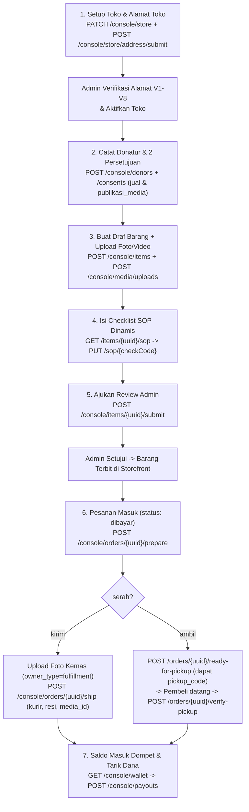

# Panduan Integrasi Frontend 2: Konsol `digitaldatagenerus` (Koordinator & Admin)

Dokumen ini adalah panduan **end-to-end** khusus untuk tim **Frontend 2 (Konsol `digitaldatagenerus`)** yang mencakup **2 peran berbeda**:
- **Admin Barokahiin (`role_id = 1`)**: `/api/v1/barokahiin/admin/*`
- **Koordinator Barokahiin (`role_id = 9`, terdaftar di `barokahiin_coordinators`)**: `/api/v1/barokahiin/console/*`
- *(Sedangkan **Pembeli Barokahiin** memakai `role_id = 10` pada Frontend 1 Storefront.)*

> **Penting — Pemisahan Routing Berdasarkan Peran:**
> - Akun **Admin** (`role_id = 1`) **TIDAK** memanggil `/barokahiin/console/dashboard` (akan mendapat `403` jika tidak terdaftar sebagai Koordinator). Arahkan Admin ke `/barokahiin/admin/dashboard`.
> - Akun **Koordinator** diarahkan ke `/barokahiin/console/dashboard`.

Dokumen pendamping:
- Postman Collection (96 request): [barokahiin-v0.5.postman_collection.json](./postman/barokahiin-v0.5.postman_collection.json) *(folder **3. Console** & **4. Admin**)*
- Panduan khusus Wilayah & Alamat (pakai `village_code`, tanpa `region_id`): [BAROKAHIIN_WILAYAH_FLOW.md](./BAROKAHIIN_WILAYAH_FLOW.md)

---

## 1. Autentikasi, Wilayah, & Konvensi

- **Base URL**: `https://apimain.digitaldatagenerus.com/api/v1` *(lokal: `http://127.0.0.1:8000/api/v1`)*
- **Login**: gunakan `POST /api/v1/login` lalu kirim `Authorization: Bearer <token>` pada setiap endpoint `/console/*` dan `/admin/*`.
- **Akun Sample Uji Lokal**:
  - Koordinator: `koordinator.sample@barokahiin.local` / `password123`
- **Header `Idempotency-Key`**: wajib/disarankan pada `POST /console/payouts`, `POST /admin/ledger/adjustments`, dan `POST /admin/pool/allocate`.
- **Cakupan Wilayah (Koordinator)**: server memfilter semua donatur, barang, pesanan, dan program berdasarkan wilayah penugasan koordinator. Akses luar wilayah dibalas `404 NOT_FOUND` / `OUT_OF_SCOPE`.
- **Optimistic Concurrency (Edit Barang)**: selalu kirim `version` pada `PATCH /console/items/{uuid}`. Jika terjadi konflik edit bersamaan (`409 VERSION_CONFLICT`), muat ulang data terbaru.

### 1.1 Dropdown Wilayah di Semua Form Konsol
Gunakan endpoint publik (tanpa token, cache 7 hari):
1. `GET /public/wilayah/provinces` → `province_code` (`"32"`)
2. `GET /public/wilayah/regencies/{provinceCode}` → `regency_code` (`"32.73"`)
3. `GET /public/wilayah/districts/{regencyCode}` → `district_code` (`"32.73.25"`)
4. `GET /public/wilayah/villages/{districtCode}` → `village_code` (`"32.73.25.1002"`)
5. *(Opsional filter organisasi)*: `GET /public/wilayah/filters` mengembalikan `administratif` + `organisasi` (`daerah`, `desa`, `kelompok`) dalam 1 request.

> Kirim langsung `village_code` / `regency_code` / `wilayah_code` ke semua endpoint form Konsol — backend otomatis menyinkronkan ke `barokahiin_regions` (tidak perlu mencari `region_id`).

---

## 2. Alur Lengkap Koordinator (`/api/v1/barokahiin/console`)



### 2.1 Dasbor, Profil Toko, & Alamat Toko
- `GET /console/dashboard` — Ringkasan `coordinator`, `store`, `items_by_status`, `orders_to_fulfill`, dan `wallet`.
- `GET /console/store`, `PATCH /console/store` — Kelola `nama`, `deskripsi`, `kebijakan_tambahan`, `jam_operasional`.
- `POST /console/store/address/submit` — Ajukan alamat toko untuk verifikasi `V1–V8`:
  ```json
  {
    "jalan_nomor": "Jl. A.H. Nasution No. 88",
    "rt_rw": "RT 02 / RW 05",
    "province_code": "32",
    "regency_code": "32.73",
    "district_code": "32.73.25",
    "village_code": "32.73.25.1002",
    "kode_pos": "40614",
    "patokan": "Dekat Bundaran Cibiru",
    "lat": -6.9312,
    "lng": 107.7176,
    "jenis_tempat": "ruko",
    "status_penguasaan": "sewa",
    "bukti_ref": "DOMISILI-001",
    "kontak_toko": "081200009999"
  }
  ```
  - Ditolak `409 ACTIVE_ORDERS_EXIST` selama masih ada pesanan aktif (`dibayar`, `disiapkan`, `siap_diambil`, `dikirim`).
- `POST /console/store/pause` (`{ "days": 1..30 }`), `POST /console/store/resume`, `GET /console/store/score`.

### 2.2 Donatur & Persetujuan Wajib
- `GET /console/donors`, `GET /console/donors/{uuid}`
- `POST /console/donors`:
  ```json
  { "village_code": "32.73.25.1002", "nama": "Ahmad Fauzi", "kontak": "081200000001", "anonim": true, "catatan": "Diantar ke sekretariat" }
  ```
- `POST /console/donors/{uuid}/consents` — **wajib catat keduanya** (`jenis: "jual"` dan `jenis: "publikasi_media"` + `bukti_ref`) sebelum barang bisa diajukan review.
- `POST /console/donors/{uuid}/anonymize` — Anonimkan data pribadi donatur atas permintaan.

### 2.3 Barang, Media, & Checklist SOP
1. **Buat Draf Barang**: `POST /console/items`
   - Field wajib: `donor_uuid`, `category_id`.
   - Field opsional: `village_code` *(otomatis ikut wilayah donatur jika kosong)*, `daerah_id`, `desa_id`, `kelompok_id`, `jalur` (`jual|charity|salurkan`), `charity_program_id`, `grade` (`A|B|C`), `judul`, `keterangan`, `kekurangan`, `weight_g`, `dim_l_cm`, `dim_w_cm`, `dim_h_cm`, `ref_new_price_idr`, `price_idr`, `lokasi_penyimpanan`, `serial_imei`.
   - Kategori terlarang (`MK`) otomatis ditolak `422 FORBIDDEN_CATEGORY`.
2. **Unggah Media**: `POST /console/media/uploads` (`multipart/form-data`)
   - Field: `owner_type` (`item|store|store_address|program|fulfillment`), `owner_uuid`, `tipe` (`foto|video`), `file`, `alt?`, `urutan?`, `check_id?`, `durasi_dtk?`, `is_cover?`.
   - EXIF/GPS otomatis dihapus server. Minimum 4 foto (maks 10), video maks 2 (≤ 60 dtk, ≤ 100 MB).
3. **Checklist SOP**:
   - `GET /console/items/{uuid}/sop` — Tampilkan checklist (`U01–U13` + kategori) dan `data.gate_errors[]`.
   - `PUT /console/items/{uuid}/sop/{checkCode}` (`{ "nilai": true, "media_id": null, "teks_keterbukaan": null }`).
4. **Submit / Tarik / Terbitkan Ulang**:
   - `POST /console/items/{uuid}/submit`, `/withdraw`, `/republish`, `/price-suggestions/{suggestionUuid}/accept`.

### 2.4 Pemenuhan Pesanan (`serah = "kirim"` vs `serah = "ambil"`)
1. Daftar pesanan masuk: `GET /console/orders` *(lihat field `serah`, `status`, `alamat_snapshot_enc`, `items[]`, `fulfillment`)*.
2. **Langkah Wajib Awal (untuk `kirim` maupun `ambil`)**:
   - Saat status `dibayar`, klik **Siapkan Pesanan** → `POST /console/orders/{uuid}/prepare` (`dibayar` → `disiapkan`).
3. **Jika `serah === "kirim"`**:
   - Step A: Unggah foto bukti pengemasan via `POST /console/media/uploads` dengan `owner_type = "fulfillment"`, `owner_uuid = <order_uuid>`, `tipe = "foto"`, `file = <foto>` → ambil `data.id` sebagai `bukti_kemas_media_id`.
   - Step B: Input resi pengiriman via `POST /console/orders/{uuid}/ship`:
     ```json
     { "kurir": "JNE REG", "resi": "BDO1234567890", "bukti_kemas_media_id": 15 }
     ```
   - Status berubah ke **`dikirim`** dan penggantian ongkir + biaya kemas langsung dikreditkan ke dompet `AVAILABLE`.
4. **Jika `serah === "ambil"`**:
   - Step A: Klik **Siap Diambil** → `POST /console/orders/{uuid}/ready-for-pickup` (`disiapkan` → `siap_diambil`). Respons mengembalikan `pickup_code` (6 karakter) untuk disampaikan ke pembeli.
   - Step B: Saat pembeli datang mengambil barang, verifikasi kode ambil via `POST /console/orders/{uuid}/verify-pickup`:
     ```json
     { "kode_ambil": "AB12CD" }
     ```
   - Status berubah langsung ke **`diterima`**.
5. **Tanggapi Komplain**: `POST /console/disputes/{uuid}/messages` (`{ "pesan": "..." }`).

### 2.5 Dompet, Penarikan, & Program Charity
- `GET /console/wallet`, `GET /console/wallet/entries`
- `PATCH /console/wallet/charity-share` (`{ "charity_share_pct": 0..100, "charity_program_id": 1 }`)
- `POST /console/payouts` (`Idempotency-Key`, `{ "jumlah_idr": 100000 }`)
- `POST /console/programs` *(terima `regency_code` / `village_code` langsung)*, `POST /console/programs/{uuid}/disbursements`, `POST /console/programs/{uuid}/reports`.

---

## 3. Alur & Endpoint Admin (`/api/v1/barokahiin/admin`)

### 3.1 Dasbor, Koordinator, Toko, & Verifikasi Alamat (`V1–V8`)
- `GET /admin/dashboard`
- `GET /admin/coordinators` → `POST /admin/coordinators/{uuid}/verify` (mendukung `regency_codes[]` / `wilayah_codes[]` seperti `["32.73", "32.77"]` — otomatis disinkronkan dari `wilayah.id`; `region_ids[]` tetap kompatibel), `POST /admin/coordinators/{uuid}/sanctions`
- `GET /admin/stores` → `POST /admin/stores/{uuid}/moderate`
- Verifikasi Alamat Toko:
  - `POST /admin/store-addresses/{addressUuid}/checks` (`kode`: `V1..V8`, `lulus`: `true|false`, `catatan?`)
  - `POST /admin/store-addresses/{addressUuid}/verify` *(butuh `V1–V7`, plus `V8` untuk Level 1)*
  - `POST /admin/store-addresses/{addressUuid}/reject` (`status`: `perlu_perbaikan|ditolak`, `alasan`)

### 3.2 Antrean Review Barang & Audit Sampling
- `GET /admin/review/queue`
- `POST /admin/items/{uuid}/review` (`keputusan`: `setuju|revisi|tolak`, `price_idr?`, `special_price_approval?`, `catatan_per_butir?`, `alasan?`)
- `POST /admin/items/{uuid}/audit` (`hasil`: `lulus|gagal`, `catatan?`)

### 3.3 Manajemen Voucher, Komplain, Payout, Ledger, Charity, & Konfigurasi
- **Voucher E-Commerce**:
  - `GET /admin/vouchers`
  - `POST /admin/vouchers` (`code`, `nama`, `deskripsi?`, `tipe`: `fixed|percent|free_shipping`, `nilai`, `max_discount_idr?`, `min_subtotal_idr`, `quota_total?`, `per_user_limit`, `store_id?`, `category_id?`, `is_public`, `is_active`, `starts_at?`, `ends_at?`)
  - `PATCH /admin/vouchers/{uuid}`, `DELETE /admin/vouchers/{uuid}`
- **Komplain & Payout**:
  - `POST /admin/disputes/{uuid}/decide`
  - `GET /admin/payouts` → `POST /admin/payouts/{uuid}/transfer` (`bukti_ref`) / `reject` (`alasan`)
- **Ledger & Charity**:
  - `GET /admin/ledger/reconciliation` (`balanced === true`)
  - `POST /admin/ledger/adjustments` (`Idempotency-Key`)
  - `POST /admin/programs/{uuid}/approve`, `POST /admin/pool/allocate` (`Idempotency-Key`), `POST /admin/disbursements/{uuid}/approve`
- **Skema Bagi Hasil & Pengaturan**:
  - `POST /admin/split-schemes`, `POST /admin/split-schemes/{uuid}/announce`
  - `GET /admin/config`, `PATCH /admin/config`, `PUT /admin/pages`, `PATCH /admin/settings`, `GET /admin/audit-logs`

---

## 4. Penanganan Kode Error di Konsol

| HTTP | `error.code` | Tindakan UI |
|---|---|---|
| `403` | Forbidden | Pastikan akun Admin diarahkan ke `/admin/*` dan akun Koordinator ke `/console/*`. |
| `404` | `NOT_FOUND` / `OUT_OF_SCOPE` | Data tidak ada atau di luar wilayah penugasan koordinator. |
| `409` | `VERSION_CONFLICT` | Barang telah diubah sesi lain — muat ulang data barang. |
| `409` | `ACTIVE_ORDERS_EXIST` | Tahan ubah alamat toko sampai pesanan aktif selesai. |
| `409` | `INVALID_TRANSITION` | Pastikan urutan status pesanan diikuti (`dibayar` → `disiapkan` → `dikirim` / `siap_diambil`). |
| `422` | `ITEM_NOT_SUBMITTABLE` / `WILAYAH_REQUIRED` / `FORBIDDEN_CATEGORY` | Tampilkan pesan dari `error.message` pada form. |
