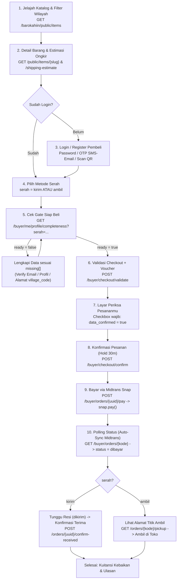

# Panduan Integrasi Frontend 1: Storefront Barokahiin (Publik & Pembeli)

Dokumen ini adalah panduan **end-to-end** khusus untuk tim **Frontend 1 (Storefront Barokahiin)** yang mengonsumsi:
- **API Publik (tanpa login)**: `/api/v1/public/wilayah/*` & `/api/v1/barokahiin/public/*`
- **API Pembeli (wajib Bearer token)**: `/api/v1/barokahiin/buyer/*`

Dokumen pendamping:
- Postman Collection (96 request): [barokahiin-v0.5.postman_collection.json](./postman/barokahiin-v0.5.postman_collection.json) *(folder **1. Public** & **2. Buyer**)*
- Panduan khusus Wilayah & Alamat: [BAROKAHIIN_WILAYAH_FLOW.md](./BAROKAHIIN_WILAYAH_FLOW.md)
- Panduan khusus Payment Gateway Midtrans: [BAROKAHIIN_PAYMENT_MIDTRANS.md](./BAROKAHIIN_PAYMENT_MIDTRANS.md)

---

## 1. Konfigurasi HTTP Client & Konvensi

- **Base URL**: `https://apimain.digitaldatagenerus.com/api/v1` *(lokal: `http://127.0.0.1:8000/api/v1`)*
- **Format Nominal**: seluruh harga/nominal adalah **integer Rupiah** (`price_idr`, `subtotal_idr`, `ongkir_idr`, `packing_fee_idr`, `voucher_discount_idr`, `rounding_donation_idr`, `total_idr`).
- **Header `Idempotency-Key`**: wajib kirim UUID unik (`crypto.randomUUID()`) pada request `POST` kritis (`auth/register`, `auth/otp/request`, `checkout/confirm`, `orders/{uuid}/pay`) agar klik ganda tidak membuat pesanan/pembayaran duplikat.
- **Format Respons Sukses**: `{ "success": true, "message": "...", "data": {} }`
- **Format Error Terstruktur**:
  ```json
  {
    "success": false,
    "message": "Profil belum lengkap untuk membuat pesanan.",
    "error": {
      "code": "PROFILE_INCOMPLETE",
      "message": "Profil belum lengkap untuk membuat pesanan.",
      "fields": { "missing": ["EMAIL_UNVERIFIED", "ADDRESS_MISSING"] },
      "request_id": "uuid"
    }
  }
  ```

```js
import axios from "axios";

export const storefrontApi = axios.create({
  baseURL: import.meta.env.VITE_API_BASE_URL,
  headers: { Accept: "application/json", "Content-Type": "application/json" },
});

export const authHeader = (token) => ({ Authorization: `Bearer ${token}` });
export const idempotentHeader = (token, key = crypto.randomUUID()) => ({
  ...(token ? { Authorization: `Bearer ${token}` } : {}),
  "Idempotency-Key": key,
});
```

---

## 2. Alur Besar Storefront (End-to-End Flowchart)



---

## 3. Endpoint Publik (Tanpa Login)

| Halaman | Endpoint | Catatan Penting |
|---|---|---|
| **Filter Wilayah** | `GET /public/wilayah/provinces`, `/regencies/{provinceCode}`, `/districts/{regencyCode}`, `/villages/{districtCode}`, `/filters` | Data resmi `wilayah.id` (cache 7 hari). Gunakan `/filters` untuk memuat administratif + `daerah`/`desa`/`kelompok` sekaligus. |
| **Katalog Barang** | `GET /barokahiin/public/items` | Filter: `q`, `category`, `province_code`, `regency_code`, `district_code`, `village_code`, `daerah_id`, `desa_id`, `kelompok_id`, `price_min`, `price_max`, `grade` (`A`/`B`/`C`), `serah` (`ambil`/`kirim`), `charity` (`true`/`false`), `sort` (`peringkat`\|`terbaru`\|`termurah`\|`termahal`), `limit` (1–100). |
| **Detail Barang** | `GET /barokahiin/public/items/{slug}` | Menyertakan `pickup_only`, `media[]`, `toko` (`area_publik`, alamat lengkap **tidak** muncul), dan `segel_kurasi`. |
| **Estimasi Ongkir** | `GET /barokahiin/public/items/{slug}/shipping-estimate?village_code=32.77.02.1001` | Menerima `village_code` / `district_code` / `regency_code` / `wilayah_code`. Jika `pickup_only === true`, ongkir `0` dan metode `kirim` harus di-disable di UI. |
| **Voucher Publik** | `GET /barokahiin/public/vouchers` | Daftar voucher aktif yang bisa dipakai di halaman checkout. |
| **Toko, Program, Dampak, Halaman** | `GET /barokahiin/public/stores`, `/stores/{slug}`, `/stores/{slug}/items`, `/programs`, `/programs/{slug}`, `/impact`, `/pages/{key}`, `/settings` | Konten publik storefront. |

---

## 4. Autentikasi Pembeli & Masa Berlaku Sesi (7 Hari)

Semua endpoint login/registrasi mengembalikan `{ token, expires_in_seconds: 604800, is_new_user, user: { id, role_id: 10, ... }, profile_completeness }`. Akun pembeli baru otomatis dibuat dengan **`role_id = 10`** (Admin = `1`, Koordinator = `9`, Pembeli = `10`).

1. **Registrasi Akun Baru**: `POST /barokahiin/public/auth/register` (`Idempotency-Key`)
   ```json
   { "nama_lengkap": "Siti Rahma", "email": "siti@example.com", "phone": "081234567890", "password": "password123" }
   ```
2. **Login Password (Email atau No. HP)**: `POST /barokahiin/public/auth/login`
   ```json
   { "identifier": "siti@example.com", "password": "password123" }
   ```
3. **Login OTP (SMS atau Email)** *(tidak pernah meminta input nama ulang saat re-login)*:
   - Minta OTP: `POST /barokahiin/public/auth/otp/request` (`Idempotency-Key`) → kirim `{ "phone": "081200008888" }` **atau** `{ "email": "pembeli.sample@barokahiin.local" }`.
   - Verifikasi OTP: `POST /barokahiin/public/auth/otp/verify` → kirim `{ "phone": "...", "code": "123456" }` **atau** `{ "email": "...", "code": "123456" }`.
4. **Login Scan QR Code** *(untuk user yang sudah login di perangkat lain)*:
   - Web/Desktop buat QR: `POST /barokahiin/public/auth/qr/create` → tampilkan QR dari `data.qr_payload` (berlaku 3 menit).
   - Web/Desktop polling 2–3 dtk: `GET /barokahiin/public/auth/qr/{qr_token}/status`.
   - Mobile (sudah login) setujui: `POST /barokahiin/buyer/auth/qr/approve` dengan `{ "qr_token": "<qr_token atau qr_payload>" }`.
5. **Perpanjang Sesi Tanpa Login Ulang**:
   - Token berlaku **7 hari (`604800` detik)**. Panggil `POST /barokahiin/buyer/auth/refresh` (Bearer token) sebelum expired untuk memperbarui token secara senyap.

---

## 5. Alur Lengkap Alamat Pembeli & Gate "Siap Beli"

### 5.1 Cara Mengisi Alamat Pembeli (Wajib untuk `serah = "kirim"`)
Frontend **tidak perlu** mencari `region_id`. Ikuti urutan dropdown berikut:

1. `GET /api/v1/public/wilayah/provinces` → pilih `province_code` (contoh `"32"`)
2. `GET /api/v1/public/wilayah/regencies/32` → pilih `regency_code` (contoh `"32.73"`)
3. `GET /api/v1/public/wilayah/districts/32.73` → pilih `district_code` (contoh `"32.73.25"`)
4. `GET /api/v1/public/wilayah/villages/32.73.25` → pilih **`village_code`** (contoh `"32.73.25.1002"`) — **wajib sampai level kelurahan/desa!**
5. Simpan alamat ke `POST /api/v1/barokahiin/buyer/me/addresses`:
   ```json
   {
     "penerima": "Siti Rahma",
     "phone_penerima": "081234567890",
     "province_code": "32",
     "regency_code": "32.73",
     "district_code": "32.73.25",
     "village_code": "32.73.25.1002",
     "kode_pos": "40614",
     "jalan_nomor": "Jl. Cipadung Raya No. 45",
     "rt_rw": "RT 03 / RW 04",
     "patokan": "Depan Indomaret Cipadung",
     "jenis_tempat": "rumah",
     "is_default": true
   }
   ```
   - **Validasi keras (`422 ADDRESS_INVALID`)**: semua field wajib di atas harus diisi, `kode_pos` 5 digit angka, `patokan` ≥ 5 karakter, `village_code` wajib tingkat kelurahan/desa.
   - **Peringatan lunak (`data.warnings[]`)**: mis. `ADDRESS_LOOKS_INCOMPLETE` atau `ADDRESS_SUSPICIOUS_TEXT` — alamat tetap tersimpan, tampilkan konfirmasi ke user agar diperiksa kembali.
   - **Auto-sync**: menyimpan alamat otomatis mengisi `region_id` & `nama_lengkap` di profil bila masih kosong dan langsung mengembalikan `data.profile_completeness` terbaru.
   - **Kelola alamat lain**: `GET /buyer/me/addresses` (maks 5 alamat), `PATCH /buyer/me/addresses/{uuid}` (edit / set default), `DELETE /buyer/me/addresses/{uuid}`.

### 5.2 Gate "Siap Beli" (`GET /barokahiin/buyer/me/profile/completeness?serah=kirim|ambil`)
Panggil saat masuk halaman checkout (dan ulangi jika user mengubah toggle `serah` antara `kirim` dan `ambil`):

| Kode pada `missing[]` | Kapan Muncul | Aksi yang Harus Ditampilkan Frontend |
|---|---|---|
| `PHONE_UNVERIFIED` | HP belum terverifikasi OTP | Arahkan ke verifikasi OTP SMS (`auth/otp/request` → `auth/otp/verify`). |
| `EMAIL_UNVERIFIED` | Email belum diverifikasi | Tampilkan tombol verifikasi email → `POST /barokahiin/buyer/me/email/verify` *(persisten lintas login, cukup 1x selamanya)*. |
| `NAME_MISSING` | Nama < 3 huruf / hanya angka | Form input nama → `PATCH /barokahiin/buyer/me/profile` (`{ nama_lengkap }`). |
| `TERMS_NOT_ACCEPTED` | Belum setuju S&K | Checkbox S&K → `PATCH /barokahiin/buyer/me/profile` (`{ accept_terms: true, terms_version: "0.5" }`). |
| `ADDRESS_MISSING` / `ADDRESS_INVALID` | Khusus **`serah = "kirim"`** | Buka form/pilih alamat (`POST /buyer/me/addresses` atau `PATCH /buyer/me/addresses/{uuid}`). |
| `REGION_MISSING` | Khusus **`serah = "ambil"`** jika belum punya alamat maupun wilayah profil | Pilih kelurahan (`village_code`) → `PATCH /barokahiin/buyer/me/profile` (`{ village_code }`). |

---

## 6. Perbedaan Alur `serah = "kirim"` vs `serah = "ambil"` saat Checkout

> **Aturan Keranjang**: 1 pesanan hanya boleh berisi barang dari **1 toko yang sama** (maks 10 barang di keranjang). Jika ada barang dengan `pickup_only: true`, metode `serah = "kirim"` akan ditolak — paksa toggle ke `serah = "ambil"`.

### Langkah 1 — Preview Voucher (Opsional)
`POST /api/v1/barokahiin/buyer/vouchers/preview`
```json
{
  "voucher_code": "BAROKAH25",
  "item_uuids": ["<uuid-barang>"],
  "serah": "kirim",
  "address_uuid": "<uuid-alamat-pembeli>"
}
```

### Langkah 2 — Validasi Checkout (Hitung Ongkir & Total, Belum Menahan Barang)
`POST /api/v1/barokahiin/buyer/checkout/validate`

- **Jika `serah = "kirim"`**:
  ```json
  {
    "item_uuids": ["<uuid-barang>"],
    "serah": "kirim",
    "address_uuid": "<uuid-alamat-dari-GET-me-addresses>",
    "voucher_code": "BAROKAH25",
    "rounding_donation_idr": 2000
  }
  ```
  - Jika `address_uuid` tidak dikirim, backend otomatis memakai alamat `is_default: true`.
  - Backend menghitung `ongkir_idr`, `packing_fee_idr`, dan `zona` (`dalam_kota` / `jawa_barat` / `luar_jawa_barat`) berdasarkan berat aktual vs volumetrik barang dan wilayah alamat pembeli.
- **Jika `serah = "ambil"`**:
  ```json
  {
    "item_uuids": ["<uuid-barang>"],
    "serah": "ambil",
    "voucher_code": "BAROKAH25",
    "rounding_donation_idr": 0
  }
  ```
  - Tidak perlu `address_uuid`. `ongkir_idr = 0` dan `packing_fee_idr = 0`.

Periksa respons `data`:
- Pastikan `ready === true` (`missing: []`, `cart_issues: []`, `voucher_error: null`).
- Tampilkan layar **"Periksa Pesananmu"** berisi rincian `data.quote` (`subtotal_idr`, `ongkir_idr`, `packing_fee_idr`, `voucher_discount_idr`, `rounding_donation_idr`, `total_idr`) serta checkbox wajib **"Data sudah benar"**.

### Langkah 3 — Konfirmasi Checkout (Mulai Hold 30 Menit)
`POST /api/v1/barokahiin/buyer/checkout/confirm` *(wajib header `Idempotency-Key`)*
```json
{
  "item_uuids": ["<uuid-barang>"],
  "serah": "kirim",
  "address_uuid": "<uuid-alamat>",
  "voucher_code": "BAROKAH25",
  "rounding_donation_idr": 2000,
  "data_confirmed": true
}
```
- Sukses (`201`): simpan `data.uuid` (`order_uuid`), `data.kode_pesanan` (`order_kode`), dan tampilkan countdown menuju `data.hold_expires_at`.

### Langkah 4 — Pembayaran Midtrans Snap & Auto-Sync
1. Buat transaksi: `POST /api/v1/barokahiin/buyer/orders/{order_uuid}/pay` (`Idempotency-Key`, body `{ "metode": "snap" }`).
2. Jalankan `window.snap.pay(data.snap_token)` (atau buka `data.redirect_url`).
3. Polling `GET /api/v1/barokahiin/buyer/orders/{order_kode}` setiap 3 detik *(backend otomatis mengecek status langsung ke Midtrans Core API bila webhook belum masuk)*, atau sediakan tombol **"Cek Status Pembayaran"** → `POST /api/v1/barokahiin/buyer/orders/{order_uuid}/sync-payment`.
4. Detail lengkap implementasi `snap.js` lihat [BAROKAHIIN_PAYMENT_MIDTRANS.md](./BAROKAHIIN_PAYMENT_MIDTRANS.md).

---

## 7. Riwayat Pesanan, State Machine Status, & Aksi UI Pembeli

- **Daftar Riwayat Pesanan Pembeli (lintas perangkat)**: `GET /api/v1/barokahiin/buyer/orders?status=&per_page=20` *(paginasi, termasuk relasi `items`, `store`, `fulfillment`, `payments`, `review` — tidak perlu mengandalkan `localStorage`)*.
- **Detail Pesanan**: `GET /api/v1/barokahiin/buyer/orders/{kode}`.

| Status Pesanan | Arti | Tombol / Aksi Pembeli yang Aktif di UI |
|---|---|---|
| `menunggu_bayar` | Menunggu pembayaran (hold 30 menit) | **Bayar Sekarang** (`snap_token`), **Cek Status Bayar** (`POST /orders/{uuid}/sync-payment`), **Batalkan** (`POST /orders/{uuid}/cancel`). |
| `dibayar` | Lunas & terverifikasi | **Lihat Kuitansi Kebaikan** (`GET /orders/{kode}/impact-receipt`).<br/>• Jika `serah = kirim`: boleh **Ubah Alamat sesama zona ongkir** (`PATCH /orders/{uuid}/address` dengan `{ address_uuid }`).<br/>• Jika `serah = ambil`: tampilkan **Alamat Lengkap Titik Ambil** (`GET /orders/{kode}/pickup`). |
| `disiapkan` | Sedang dikemas / disiapkan koordinator | Tampilkan progres; alamat tidak bisa diubah lagi (`409`). |
| `dikirim` *(khusus `kirim`)* | Sudah diserahkan ke kurir | Tampilkan `fulfillment.kurir` & `fulfillment.resi` dari `GET /orders/{kode}`. Aktifkan tombol **Pesanan Diterima** (`POST /orders/{uuid}/confirm-received`). |
| `siap_diambil` *(khusus `ambil`)* | Siap diambil di titik ambil | Tampilkan alamat lengkap, **`pickup_code` (6 karakter)**, dan `ambil_deadline` dari `GET /orders/{kode}/pickup` (atau field `pickup_code` pada `GET /orders` & `GET /orders/{kode}`). Pembeli menunjukkan `pickup_code` tersebut ke Koordinator saat serah terima. |
| `diterima` | Barang sudah diterima pembeli | Aktifkan **Beri Ulasan** (`POST /orders/{uuid}/reviews` dengan `{ rating: 1..5, komentar? }` — juga kompatibel dengan `{ rating_barang, rating_layanan, teks? }`) dan **Ajukan Komplain** (`POST /orders/{uuid}/disputes` dalam 48 jam). |
| `selesai` | Transaksi final | Tampilkan riwayat & Kuitansi Kebaikan. |
| `kedaluwarsa` / `dibatalkan` | Hold habis atau dibatalkan | Tampilkan status batal/expired & tombol kembali ke katalog. |

---

## 8. Penanganan Kode Error Penting

| HTTP | `error.code` | Tindakan UI |
|---|---|---|
| `422` | `PROFILE_INCOMPLETE` | Baca `error.fields.missing[]` dan buka layar **Lengkapi Data**. |
| `422` | `ADDRESS_INVALID` / `WILAYAH_INVALID` | Sorot field error di form alamat (`error.fields`). |
| `422` | `VOUCHER_INVALID` | Tampilkan alasan voucher tidak berlaku dan hapus voucher dari ringkasan. |
| `409` | `ITEM_UNAVAILABLE` | Barang sudah ditahan/terjual — refresh keranjang & hapus barang tersebut. |
| `409` | `ORDER_UNDER_REVIEW` | Tampilkan pesan bahwa pesanan terkait akun koordinator pengelola barang. |
| `409` | `ADDRESS_CHANGE_NOT_ALLOWED` | Alamat baru berbeda zona ongkir atau pesanan sudah mulai disiapkan. |
| `403` | `PICKUP_NOT_AVAILABLE` | Alamat titik ambil hanya terbuka setelah pesanan `ambil` berstatus `dibayar`. |
