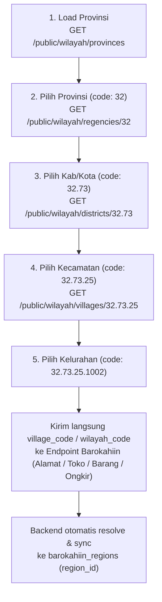

# Panduan Alur Wilayah Barokahiin (Frontend Storefront & Console)

Dokumen ini adalah **panduan resmi satu pintu** untuk implementasi dropdown wilayah, filter katalog, pengisian alamat pembeli, alamat toko, donatur, barang, program charity, dan estimasi ongkir.

> **Prinsip Utama (Penting untuk Frontend):**
> Frontend **TIDAK perlu** mencari atau menyimpan `region_id` internal database lagi!
> Cukup gunakan **kode resmi dari API Wilayah** (`province_code`, `regency_code`, `district_code`, `village_code`, atau `wilayah_code`) langsung pada seluruh form. Backend otomatis menyinkronkan hierarki `wilayah.id` ke database internal.

---

## 1. Alur Ringkas (Flowchart)



---

## 2. Daftar Endpoint Dropdown Wilayah

Semua endpoint di bawah ini **publik (tanpa token)** dan sudah di-cache 7 hari di backend (mengambil data resmi dari `wilayah.id`).

| Tahap | Endpoint | Contoh `code` yang Diterima |
|---|---|---|
| 1. Provinsi | `GET /api/v1/public/wilayah/provinces` | `32` (Jawa Barat) |
| 2. Kab / Kota | `GET /api/v1/public/wilayah/regencies/{provinceCode}` | `32.73` (Kota Bandung) |
| 3. Kecamatan | `GET /api/v1/public/wilayah/districts/{regencyCode}` | `32.73.25` (Cibiru) |
| 4. Kelurahan / Desa | `GET /api/v1/public/wilayah/villages/{districtCode}` | `32.73.25.1002` (Cipadung) |
| **Gabungan (1x Call)** | `GET /api/v1/public/wilayah/filters?province_code=32&regency_code=32.73` | Mengembalikan `administratif` (`provinces`, `regencies`, `districts`, `villages`) **+ `organisasi`** (`daerah`, `desa`, `kelompok`) sekaligus. |

Format setiap item administratif selalu konsisten:
```json
{ "code": "32.73.25.1002", "name": "Cipadung" }
```

---

## 3. Aturan Pengiriman Kode Wilayah di Semua Form

Backend mendukung **salah satu** dari field berikut (otomatis memilih level paling spesifik):
1. `village_code` *(paling spesifik, disarankan untuk alamat)* — contoh: `"32.73.25.1002"`
2. `district_code` — contoh: `"32.73.25"`
3. `regency_code` — contoh: `"32.73"`
4. `province_code` — contoh: `"32"`
5. `wilayah_code` *(alternatif 1 field saja yang menerima level mana pun)* — contoh: `"32.73.25.1002"`

> Jika frontend mengirim keempat field (`province_code`, `regency_code`, `district_code`, `village_code`) sekaligus dari state form dropdown, itu **100% valid** — backend otomatis memakai level terdalam (`village_code`).

---

## 4. Contoh Implementasi per Fitur

### A. Filter Katalog Barang (Storefront)
`GET /api/v1/barokahiin/public/items`

Kirim kode wilayah administratif **dan/atau** wilayah organisasi sesuai pilihan user:
```http
GET /api/v1/barokahiin/public/items?province_code=32&regency_code=32.73&daerah_id=1
```
Parameter yang didukung:
- Administratif: `province_code`, `regency_code`, `district_code`, `village_code`
- Organisasi: `daerah_id`, `desa_id`, `kelompok_id`

---

### B. Estimasi Ongkir (Storefront)
`GET /api/v1/barokahiin/public/items/{slug}/shipping-estimate`

```http
GET /api/v1/barokahiin/public/items/sample-rak-buku-jati/shipping-estimate?village_code=32.77.02.1001
```
*(Bisa juga pakai `?regency_code=32.77` atau `?wilayah_code=32.77.02.1001`.)*

---

### C. Lengkapi Profil & Alamat Pembeli (Storefront)

1. **Update Profil Pembeli**: `PATCH /api/v1/barokahiin/buyer/me/profile`
   ```json
   {
     "nama_lengkap": "Siti Rahma",
     "village_code": "32.73.25.1002",
     "accept_terms": true,
     "terms_version": "0.5"
   }
   ```

2. **Tambah Alamat Pengiriman Pembeli**: `POST /api/v1/barokahiin/buyer/me/addresses`
   ```json
   {
     "penerima": "Siti Rahma",
     "phone_penerima": "081234567890",
     "province_code": "32",
     "regency_code": "32.73",
     "district_code": "32.73.25",
     "village_code": "32.73.25.1002",
     "kode_pos": "40614",
     "jalan_nomor": "Jl. Cipadung Raya No. 45",
     "rt_rw": "RT 03 / RW 04",
     "patokan": "Depan Indomaret Cipadung",
     "jenis_tempat": "rumah",
     "is_default": true
   }
   ```

---

### D. Pengisian Alamat Toko Koordinator (Console)
`POST /api/v1/barokahiin/console/store/address/submit`

```json
{
  "jalan_nomor": "Jl. A.H. Nasution No. 88",
  "rt_rw": "RT 02 / RW 05",
  "province_code": "32",
  "regency_code": "32.73",
  "district_code": "32.73.25",
  "village_code": "32.73.25.1002",
  "kode_pos": "40614",
  "patokan": "Dekat Bundaran Cibiru",
  "lat": -6.9312,
  "lng": 107.7176,
  "jenis_tempat": "ruko",
  "status_penguasaan": "sewa",
  "bukti_ref": "DOMISILI-001",
  "kontak_toko": "081200009999"
}
```
> **Penting:** Pastikan wilayah toko berada di dalam cakupan wilayah penugasan koordinator.

---

### E. Catat Donatur, Barang, & Program Charity (Console)

1. **Catat Donatur**: `POST /api/v1/barokahiin/console/donors`
   ```json
   {
     "village_code": "32.73.25.1002",
     "nama": "Ahmad Fauzi",
     "kontak": "081200000001",
     "anonim": true
   }
   ```

2. **Buat Draf Barang**: `POST /api/v1/barokahiin/console/items`
   - `village_code` / `wilayah_code` bersifat **opsional** (jika dikosongkan, otomatis mengikuti wilayah donatur).
   - Opsional sertakan `daerah_id`, `desa_id`, `kelompok_id` jika ingin barang muncul di filter organisasi.
   ```json
   {
     "donor_uuid": "<uuid-donatur>",
     "category_id": 4,
     "village_code": "32.73.25.1002",
     "daerah_id": 1,
     "desa_id": 2,
     "kelompok_id": 5,
     "judul": "Rak Buku Kayu Jati",
     "grade": "B",
     "price_idr": 250000
   }
   ```

3. **Ajukan Program Charity**: `POST /api/v1/barokahiin/console/programs`
   ```json
   {
     "regency_code": "32.73",
     "judul": "Beasiswa Santri Bandung Timur",
     "tujuan": "Membantu biaya pendidikan 25 santri.",
     "penerima_manfaat_desc": "25 pelajar SD-SMP di Kecamatan Cibiru.",
     "target_idr": 5000000
   }
   ```

---

## 5. Do & Don't untuk Tim Frontend

| ✅ Lakukan (DO) | ❌ Hindari (DON'T) |
|---|---|
| Simpan `code` dari `/public/wilayah/*` (`"32.73.25.1002"`) di state form dan kirim sebagai `village_code` / `wilayah_code`. | Jangan hardcode `region_id` angka (seperti `region_id: 4`) karena ID internal bisa berubah saat reset database. |
| Reset dropdown anak (`regency` → `district` → `village`) setiap kali parent berubah. | Jangan mengirim kode wilayah lama dari parent sebelumnya saat user mengganti provinsi/kabkota. |
| Gunakan `GET /public/wilayah/filters` untuk modal filter katalog agar administratif + `daerah`/`desa`/`kelompok` ter-load dalam 1 request. | Jangan memanggil `https://wilayah.id/api/*` langsung dari browser (rawan CORS & tanpa cache backend). Selalu lewat `/api/v1/public/wilayah/*`. |
| Tangani error `422 WILAYAH_INVALID` atau `422 WILAYAH_REQUIRED` dengan menampilkan pesan dari `error.message`. | Jangan men-submit form alamat sebelum minimal level kelurahan (`village_code`) dipilih. |
