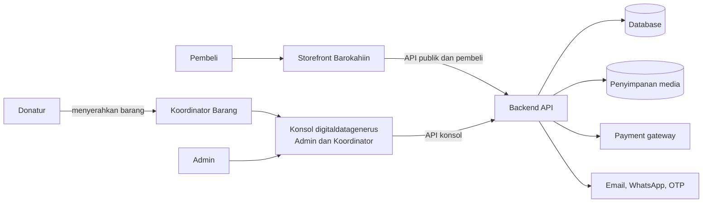
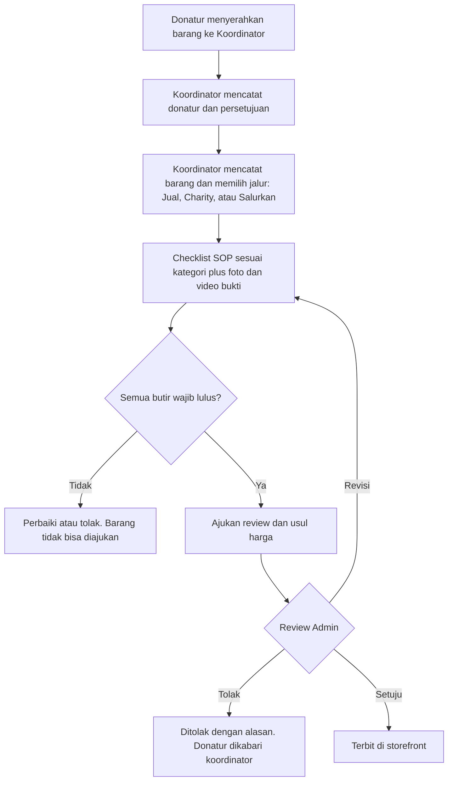
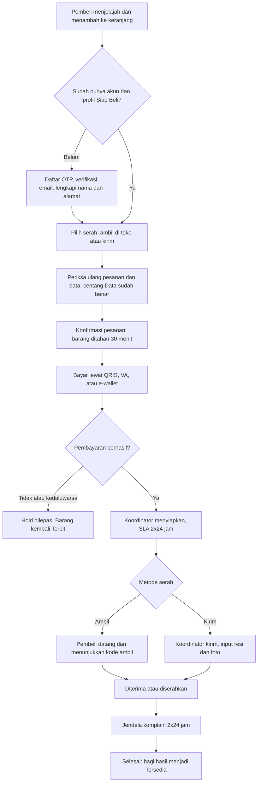
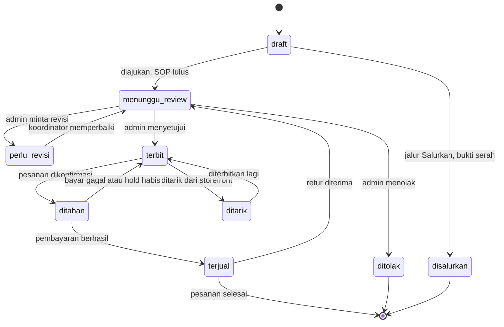
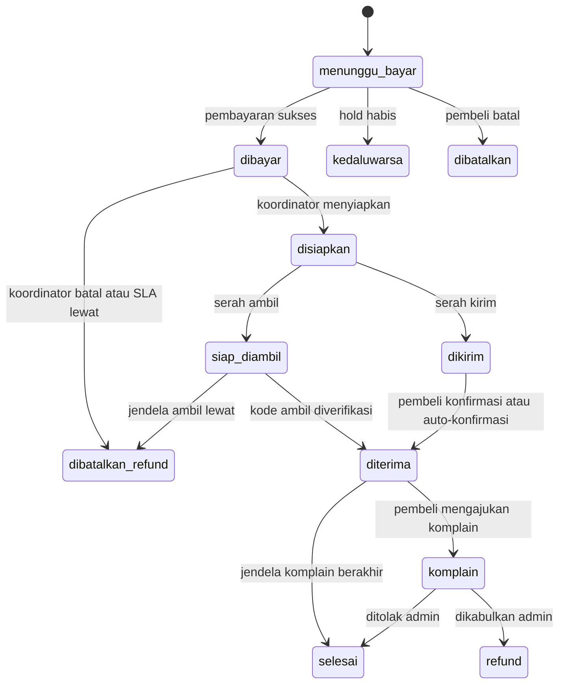
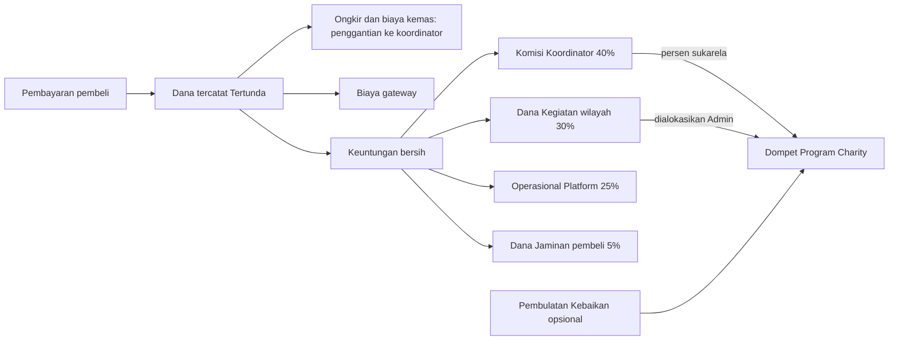
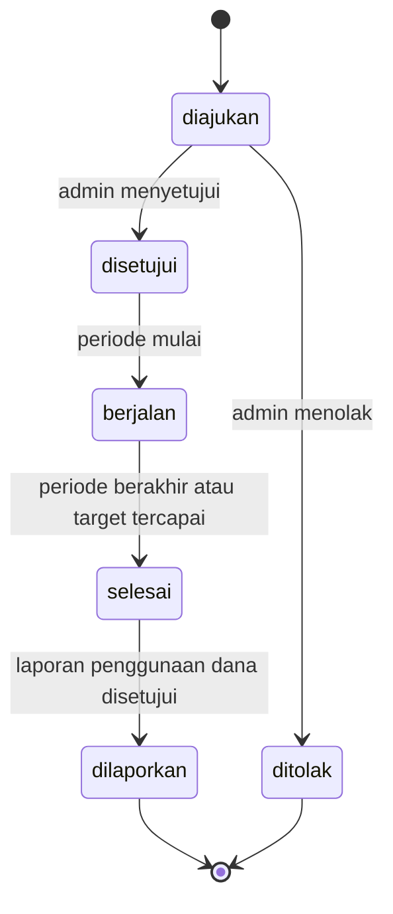

# PRD: Barokahiin

| | |
|---|---|
| **Versi** | 0.5 (akun pembeli wajib, Toko koordinator dengan alamat terverifikasi, model bisnis dan bagi hasil ditetapkan) |
| **Tanggal** | 20 November 2026 |
| **Pemilik produk** | _(isi nama)_ |
| **Status** | Siap dikerjakan untuk MVP. Hal yang masih butuh input pemilik ada di [Bagian 16](#16-input-yang-masih-dibutuhkan-dari-pemilik-produk), dan **semuanya sudah punya nilai bawaan** sehingga developer tidak perlu menunggu |
| **Pembaca** | UI/UX, Frontend, Backend, QA, Operasional |

> **Catatan jujur.**
> - Yang berlabel **[Asumsi]** atau **[Usulan]** belum divalidasi dengan pengguna nyata. Dokumen ini **tidak memuat data pasar atau klaim tentang pesaing**, karena belum ada sumbernya.
> - **Persentase bagi hasil dan model bisnis sudah saya tetapkan sebagai nilai awal pilot** di `model-bisnis.md` (Koordinator 40 · Kegiatan 30 · Operasional 25 · Dana Jaminan 5), lengkap dengan asumsi dan alasannya. Itu **bukan nasihat keuangan atau hukum**; angkanya harus diuji lewat pilot dan ditinjau akuntan dan konsultan hukum. Angka simulasi adalah **ilustrasi**.
> - **Aspek hukum, pajak, dan perizinan belum ditinjau.** Karena ada penjualan, komisi, dan penghimpunan dana kegiatan, ini menjadi **syarat sebelum peluncuran publik** (Bagian 13).
> - Saya tidak punya informasi tentang sistem `digitaldatagenerus` selain yang Anda sebut. Karena itu PRD mendefinisikan **kontrak (perilaku + API)**, bukan kode (Bagian 2, D3).

### Riwayat revisi
| Versi | Perubahan |
|---|---|
| 0.1–0.2 | Berbagi barang antarpengguna (arsip) |
| 0.3 | Katalog jual dikelola admin, dua frontend (arsip) |
| **0.4** | **Produk menjadi e-commerce.** Peran: Admin, **Koordinator Barang per wilayah**, Pembeli. Ditambah: **SOP per jenis barang**, **pembagian keuntungan**, **keuntungan koordinator**, **Charity**, pembayaran online, pemenuhan pesanan, komplain dan retur, dompet dan penarikan. Makanan **tidak** diizinkan dulu. **Semua keputusan terbuka v0.3 dikunci dengan nilai bawaan** (Bagian 2) |
| **0.5** | **Akun pembeli wajib** dengan **Kelengkapan Profil** dan pemeriksaan ulang sebelum bayar. **Toko milik koordinator** dengan **alamat lengkap yang diverifikasi Admin**. **Skema bagi hasil ditetapkan (40/30/25/5)** dan **model bisnis serta Mesin Toko** (peringkat, harga, umur stok, skor toko) ditulis di `model-bisnis.md`. **Peraturan koordinator** di `aturan-koordinator.md`. Ditambah Dana Jaminan, biaya kemas, harga minimum, dan penggantian ongkir ke koordinator |

## Dokumen pendamping
| File | Isi | Untuk |
|---|---|---|
| `prd.md` (ini) | Produk, aturan bisnis, SOP, bagi hasil, charity, kebutuhan | Semua |
| `backend-spec.md` | Instruksi backend: arsitektur, model data, mesin status, ledger, API, jobs, keamanan, pengujian | Backend, QA |
| `frontend-spec.md` | Instruksi frontend: arah desain, sistem desain, responsif, spesifikasi halaman, performa | Frontend, UI/UX |
| `model-bisnis.md` | Model bisnis, bagi hasil yang ditetapkan, titik impas, **Mesin Toko** (algoritma), janji ke pembeli, proses bisnis, pilot | Pemilik produk, Backend |
| `aturan-koordinator.md` | **Peraturan koordinator wilayah**: syarat, toko, **alamat terverifikasi**, kewajiban, larangan, SLA, sanksi | Operasional, Legal, semua |
| `arsip/` | PRD v0.2, v0.3 | Rujukan |

---

## 1. Ringkasan

**Barokahiin** adalah e-commerce barang layak pakai yang **dikurasi oleh koordinator lokal**, dengan **bagi hasil otomatis** dan **charity bawaan**.

> **Barang layak, dikurasi orang di wilayahmu, dan setiap rupiah bisa dilacak sampai ke kebaikan.**

**Cara kerjanya:**
1. **Donatur** menyerahkan barang kepada **Koordinator Barang** di wilayahnya.
2. Koordinator, yang memiliki **Toko** sendiri dengan **alamat terverifikasi Admin**, memeriksa barang sesuai **SOP per jenis barang**, mengambil foto/video bukti, menulis keterangan jujur, dan mengajukan harga.
3. **Admin** meninjau, lalu barang **terbit** di website.
4. **Pembeli** (berakun, dengan profil lengkap) membuat pesanan dan membayar online. Barang diambil di titik **toko** koordinator atau dikirim.
5. Keuntungan dibagi **otomatis** sesuai skema: sebagian untuk **koordinator**, sebagian untuk **dana kegiatan/charity**, sebagian untuk **operasional**, dan sebagian untuk **dana jaminan pembeli**.
6. Koordinator juga bisa menjalankan **program Charity** dan menyalurkan barang langsung.

**Bukan marketplace terbuka.** Pembeli tidak menjual. Penjualnya satu: Barokahiin, melalui toko koordinator wilayah. Inilah yang membuat kualitas dan kepercayaan bisa dijaga.

**Tagline [Usulan]:** "Barang yang kamu beli, kebaikan yang kita danai."

---

## 2. Register keputusan (agar developer tidak ragu)

Status: **Dikunci** = jangan diubah tanpa revisi PRD. **Konfigurasi** = nilai bawaan ada, bisa diubah admin tanpa rilis kode. **Input pemilik** = butuh angka/kebijakan dari pemilik; developer memakai nilai bawaan sementara.

| # | Keputusan | Status |
|---|---|---|
| D1 | Model: e-commerce kurasi, **satu penjual (Barokahiin)**, pembeli tidak menjual | Dikunci |
| D2 | Tiga peran: **Admin**, **Koordinator Barang** (per wilayah, **memiliki Toko sendiri**), **Pembeli**. Donatur adalah **subjek data**, tanpa akun | Dikunci |
| D3 | **Dua frontend + satu backend**: **Konsol** (`digitaldatagenerus`; dipakai Admin dan Koordinator) dan **Storefront** (Pembeli). Kontrak antar-sistem = **OpenAPI**. Bila `digitaldatagenerus` sudah ada, ia boleh dipakai selama **memenuhi kontrak ini** | Dikunci |
| D4 | Pembeli: **akun wajib untuk membuat pesanan** (daftar via OTP HP + verifikasi email). **Menjelajah dan keranjang tanpa akun.** Profil harus **lengkap ("Siap Beli")** dan data **diperiksa ulang sebelum bayar** | Dikunci |
| D5 | Pembayaran **online via payment gateway berizin** (QRIS, transfer VA bank, e-wallet). **Tidak ada tunai/COD**. Aplikasi tidak menyimpan data kartu/rekening pembeli | Dikunci |
| D6 | Serah: **ambil di titik koordinator** (kode ambil) dan **kirim kurir**. Fase 1: ongkir dari **tabel zona × berat** yang diatur admin, resi diinput koordinator. Agregator ongkir/pelacakan otomatis di Fase 2 | Dikunci |
| D7 | Harga: **koordinator mengusulkan dalam pedoman harga**, **admin menyetujui** | Dikunci |
| D8 | **Makanan, minuman, dan barang cepat kedaluwarsa tidak diizinkan** di Fase 1 | Dikunci |
| D9 | Barang **unik (stok 1)** secara default. Saat **pesanan dikonfirmasi** (setelah profil lengkap dan data diperiksa), barang **ditahan 30 menit** | Konfigurasi |
| D10 | Bagi hasil **otomatis per transaksi**; skema **berversi** dan **di-snapshot**. **Nilai awal: Koordinator 40 · Dana Kegiatan 30 · Operasional 25 · Dana Jaminan 5 · Donatur 0** (alasan dan simulasi di `model-bisnis.md`) | Dikunci (struktur) / Konfigurasi (angka; ditinjau tiap triwulan) |
| D11 | Komisi koordinator: **Tertunda → Tersedia** setelah jendela komplain berakhir. Penarikan **manual per batch** oleh admin keuangan di Fase 1. **Penggantian ongkir dan biaya kemas** ke koordinator (Tersedia saat dikirim dengan bukti resi) | Dikunci |
| D12 | **Charity**: program harus disetujui admin; **4 sumber dana**; ada **Barang Charity** dan **Barang Salurkan**; **Dompet Program** terpisah dari dompet pribadi | Dikunci |
| D13 | **SOP**: checklist per kategori, **dipaksa sistem** (barang tidak bisa diajukan bila butir wajib belum lulus), ditinjau admin, diaudit sampling | Dikunci (mekanisme) / Konfigurasi (isi) |
| D14 | Komplain: **48 jam** sejak barang diterima, dengan bukti foto/video; admin memutus | Konfigurasi |
| D15 | Wilayah: koordinator ditugaskan per **Kabupaten/Kota** (bisa sampai kecamatan). Pilot: **Bandung dan sekitarnya** | Dikunci |
| D16 | Video: **≤ 60 detik, ≤ 100 MB, maksimal 2 per barang** | Konfigurasi |
| D17 | Koordinator **wajib verifikasi** identitas, rekening (atas nama yang sama), dan **alamat toko** (oleh Admin). Pembeli dan donatur tidak | Dikunci |
| D18 | **2FA wajib** untuk Admin dan Koordinator sebelum peluncuran publik | Dikunci |
| D19 | Model berbagi antarpengguna (v0.2) dan Jalur Segera **keluar dari roadmap** (arsip) | Dikunci |
| D20 | Sponsor: Fase 2, berlabel jelas, tidak memengaruhi urutan katalog | Dikunci |
| D21 | Hukum, pajak, perizinan: **gerbang sebelum rilis publik** | Input pemilik |
| D22 | Merek, nama final, domain | Input pemilik |
| D23 | **Toko koordinator**: setiap koordinator aktif punya satu Toko (profil, katalog, rating, level). **Tidak bisa menerbitkan barang sebelum alamat toko terverifikasi** | Dikunci |
| D24 | **Alamat toko wajib lengkap dan terstruktur** (pin peta, foto, bukti alamat) dan **diverifikasi Admin** (V1–V8 di `aturan-koordinator.md`); alamat lengkap hanya dibuka ke pembeli yang sudah bayar | Dikunci |
| D25 | **Peraturan koordinator** berlaku sebagai syarat aktivasi (`aturan-koordinator.md`), disetujui digital dengan versi tercatat | Dikunci (isi ditelaah hukum) |
| D26 | **Model bisnis**: tanpa biaya layanan pembeli; **biaya kemas Rp 2.000** untuk koordinator; **harga minimum Rp 15.000**; Barang Charity 95% program / 5% Dana Jaminan, maks. 20% dari barang aktif toko | Konfigurasi |
| D27 | **Mesin Toko**: peringkat katalog adil dan deterministik, **tidak bisa dibeli**, sponsor tidak berpengaruh; saran harga dan turun harga; Skor Toko menentukan level | Dikunci (prinsip) / Konfigurasi (bobot) |

---

## 3. Tujuan dan non-tujuan

### Tujuan
| # | Tujuan | Ukuran |
|---|---|---|
| T1 | Barang donasi terjual dan menghasilkan dana kebaikan | Dana kebaikan per bulan (TBD) |
| T2 | Kualitas barang konsisten lewat SOP | Tingkat komplain, tingkat lolos review pertama (TBD) |
| T3 | Koordinator termotivasi dan terpercaya | Koordinator aktif, waktu proses, kepuasan (TBD) |
| T4 | Pembeli percaya dan mudah membeli | Konversi, ulasan, pembelian ulang (TBD) |
| T5 | Dana terlacak dan transparan | Selisih rekonsiliasi = 0; laporan program tepat waktu |
| T6 | Tampilan dan responsivitas kelas atas | Core Web Vitals "baik" di perangkat nyata |

### Non-tujuan (Fase 1)
Penjualan oleh pembeli/pihak ketiga · makanan dan minuman · lelang/tawar-menawar · COD/tunai · aplikasi native · donasi langsung publik (butuh tinjauan hukum, Fase 3) · bahasa daerah.

---

## 4. Peran, hak akses, dan wilayah

### 4.1 Peran
| Peran | Tugas utama |
|---|---|
| **Admin** | Mengelola sistem: wilayah, koordinator, SOP, pedoman harga, skema bagi hasil, tabel ongkir; meninjau dan menyetujui barang; memutus komplain; memproses penarikan; menyetujui program charity; laporan dan audit. Preset peran: **Super Admin**, **Reviewer** (kurasi), **Keuangan** |
| **Koordinator Barang** | **Memiliki Toko sendiri** (alamat lengkap diverifikasi Admin). Di wilayahnya: mengumpulkan barang dari donatur, mencatat donatur, memeriksa barang sesuai SOP, mengunggah foto/video dan keterangan, mengajukan harga, menyiapkan dan menyerahkan/mengirim pesanan, menangani komplain, mengelola dompet dan penarikan, menjalankan program Charity |
| **Pembeli** | Menjelajah (tanpa akun), **mendaftar dan melengkapi profil**, membeli, membayar, melacak, mengonfirmasi, mengulas, mengajukan komplain, dan opsional menambah Pembulatan Kebaikan |
| **Donatur** | Subjek data. Tidak punya akun. Dikabari koordinator |

### 4.2 Matriks izin
✔ = boleh · **W** = hanya wilayahnya · **M** = hanya miliknya · — = tidak

| Kemampuan | Publik | Pembeli | Koordinator | Admin |
|---|---|---|---|---|
| Lihat katalog, kegiatan, dampak | ✔ | ✔ | ✔ | ✔ |
| Membeli (butuh **akun + profil Siap Beli**) | — | ✔ | — (dilarang membeli barang yang dikelolanya) | — |
| Kelola donatur | — | — | **W** | ✔ |
| Buat dan ubah barang | — | — | **M** | ✔ (dengan alasan) |
| Menyetujui barang terbit | — | — | — (auto-publish hanya level tinggi, Fase 2) | ✔ Reviewer |
| Menetapkan harga final | — | — | Mengusulkan | ✔ |
| Memproses pesanan (siapkan, serah, kirim) | — | — | **M** | ✔ |
| Melihat kontak/alamat pembeli | — | Data sendiri | Pesanan **M** yang sudah dibayar, secukupnya | ✔ |
| Memutus komplain | — | — | Menanggapi | ✔ |
| Dompet dan riwayat komisi | — | — | **M** | ✔ Keuangan (semua) |
| Mengajukan penarikan | — | — | **M** | — |
| Memproses penarikan | — | — | — | ✔ Keuangan |
| Mengajukan program Charity | — | — | ✔ | — |
| Menyetujui program/pencairan Charity | — | — | — | ✔ |
| Mengubah SOP, skema, ongkir, pedoman harga | — | — | — | ✔ Super Admin |
| Mengelola Toko sendiri (profil, jam, jeda; alamat via verifikasi) | — | — | **M** | ✔ |
| Memverifikasi alamat toko dan moderasi nama/konten toko | — | — | — | ✔ Reviewer |
| Mengelola koordinator dan wilayah | — | — | — | ✔ |

### 4.3 Aturan wilayah
1. Koordinator ditugaskan ke satu atau lebih **Kabupaten/Kota** (opsional sampai kecamatan).
2. Satu wilayah punya **satu Koordinator Utama** dan boleh ada koordinator tambahan (tim).
3. Koordinator **hanya melihat dan mengubah data wilayahnya** (donatur, barang, pesanan). Ini ditegakkan di server (Bagian 10, AUT-03).
4. **Titik Ambil = alamat toko yang sudah diverifikasi Admin** (lihat 10.2a, TKO). Area publik (kecamatan) tampil di storefront; **alamat lengkap hanya dibuka ke pembeli setelah pesanan dibayar**. Toko **tidak dapat menerbitkan barang** sebelum alamat terverifikasi.
5. Asal ongkir = wilayah koordinator pemilik barang.

### 4.4 Siklus dan level koordinator
**Mendaftar → Verifikasi (identitas, rekening atas nama sama, setuju perjanjian dan SOP) → Aktif.**

| Level | Syarat naik **[Usulan, nilai di konfigurasi]** | Hak |
|---|---|---|
| **1 Baru** | Lolos verifikasi | Semua barang **wajib review admin**; batas barang aktif rendah; boleh mengajukan **program Charity kecil** (batas nilai di konfigurasi) |
| **2 Terpercaya** | Sejumlah barang selesai, komplain rendah, lolos audit sampling | Batas barang aktif dan batas nilai program Charity lebih tinggi |
| **3 Utama** | Kinerja konsisten | **Auto-publish** untuk kategori berisiko rendah (Fase 2); jadi Koordinator Utama wilayah |

**Sanksi** (tercatat dan terlihat di dasbor): peringatan → pembatasan (batas barang turun, wajib review) → penangguhan. Barang yang **terbukti tidak sesuai SOP**: komisi barang itu dibatalkan dan biaya retur terkait dipotong dari bagian koordinator.

### 4.5 Pembeli
**Akun wajib untuk membuat pesanan.** Menjelajah katalog dan mengisi keranjang boleh tanpa akun (keranjang disimpan di perangkat dan **digabung saat masuk**).

**Kelengkapan Profil "Siap Beli"** (dihitung dan ditegakkan **server**):

| Syarat | Keterangan |
|---|---|
| Nomor HP terverifikasi | OTP |
| Email terverifikasi | Tautan verifikasi |
| Nama lengkap | Dipakai untuk penerima dan kuitansi |
| Persetujuan Syarat Layanan dan Kebijakan Privasi | Versi dan waktu tercatat |
| **Kirim:** minimal satu **alamat lengkap yang valid** | Field wajib, wilayah dari master, kode pos, patokan |
| **Ambil di tempat:** wilayah dan nomor HP cukup | |

Bila belum lengkap, pembeli **boleh mulai membuat pesanan**, tetapi sistem **menahan di layar "Lengkapi data"** dan mengembalikannya ke checkout dengan keranjang utuh. Tujuannya **mencegah kesalahan manusia** (nomor salah, alamat tidak lengkap) **sebelum** uang berpindah.

**Pencegahan salah input (wajib):**
1. Nomor HP dinormalisasi dan diverifikasi; email diverifikasi.
2. Alamat dipilih bertingkat dari **master wilayah**, **kode pos** terisi otomatis, **jalan + nomor**, **RT/RW**, **patokan** wajib; **peringatan** bila alamat tampak tidak lengkap.
3. **Layar "Periksa pesananmu"**: barang, ambil/kirim, alamat, nomor HP, ongkir, total, dan **centang "Data sudah benar"** sebelum pesanan dikonfirmasi.
4. **Idempoten**: tidak ada pesanan ganda karena klik berulang.
5. **Koreksi alamat setelah bayar** hanya sampai koordinator mulai menyiapkan, dan hanya dalam zona ongkir yang sama.

Data pembeli: nama, nomor HP, email, alamat (bila kirim), riwayat pesanan.

---

## 5. Pembeda dari e-commerce biasa

Dibandingkan e-commerce umum, Barokahiin harus **lebih unggul pada kepercayaan, kejujuran barang, kedekatan lokal, dan dampak yang terlacak**. Saya tidak membandingkan dengan produk pesaing tertentu karena belum ada data. Pembeda berikut diturunkan dari mekanisme rapat Anda.

| # | Pembeda | Masalah yang dijawab | Ringkasan | Fase |
|---|---|---|---|---|
| 1 | **Kuitansi Kebaikan** | Pembeli tidak tahu uangnya ke mana | Setiap pesanan menghasilkan kuitansi bergaya struk: harga barang, biaya transaksi, keuntungan, pembagiannya (koordinator wilayah, dana kegiatan, operasional), dan program yang didanai. Ini **elemen paling khas** produk | MVP |
| 2 | **Segel Kurasi** (hasil SOP terlihat) | Barang bekas diragukan kualitasnya | Setiap barang menampilkan hasil pemeriksaan SOP-nya (butir yang lulus, bukti foto/video, grade A/B/C) dan siapa koordinator yang memeriksanya | MVP |
| 3 | **Kejujuran cacat wajib** | Foto bagus, aslinya beda | Kolom kekurangan wajib, foto close-up cacat wajib, grade baku. **Garansi Sesuai Deskripsi**: dana ditahan sampai jendela komplain berakhir | MVP |
| 4 | **Koordinator lokal yang terlihat** | Penjual anonim | Barang "dikurasi oleh Koordinator [Wilayah]" dengan profil publik, level, dan ulasan. Mendukung ambil di tempat dan ongkir lebih dekat | MVP (profil: Fase 2) |
| 5 | **Charity bawaan** | Berbagi kebaikan terpisah dari belanja | Barang Charity (95% keuntungan ke program), Pembulatan Kebaikan opsional, program koordinator dengan laporan publik | MVP |
| 6 | **Barang unik yang ditahan adil** | Rebutan barang satu-satunya | Hold 30 menit saat pesanan dikonfirmasi dengan hitung mundur jujur. **Tanpa kelangkaan palsu** | MVP |
| 7 | **Transparansi dana publik** | Ragu pada penghimpunan dana | Halaman dampak per wilayah dan program, dengan dokumentasi dan laporan penggunaan | MVP |
| 8 | **Video bukti fungsi** | Barang elektronik/alat tidak bisa dicek | Video ≤ 60 detik wajib untuk jenis tertentu (SOP), memperlihatkan barang menyala dan berfungsi | MVP |
| 9 | **Radar wilayah** | Pencarian lokal sulit | Filter dan penelusuran per wilayah, ambil sendiri vs kirim, peta titik ambil | MVP (peta: Fase 2) |
| 10 | **Bagi hasil adil dan terukur** | Motivasi koordinator tidak jelas | Dompet koordinator dengan rincian per pesanan, komisi Tertunda/Tersedia, penarikan | MVP |
| 11 | **Kabar dampak ke donatur** | Donatur tidak tahu barangnya terjual | Templat pesan "barangmu terjual dan mendanai ..." via koordinator; donatur anonim terjaga | Fase 2 |
| 12 | **Saran harga adil** | Harga asal-asalan | Pedoman harga per kategori × grade; peringatan bila di luar rentang | MVP (saran otomatis: Fase 2) |
| 13 | **Notifikasi WhatsApp** | Pembeli/koordinator tidak memantau email | Status pesanan dan pesanan baru lewat WhatsApp | Fase 2 |
| 14 | **Kinerja koordinator yang adil** | Kualitas tidak merata | Level, SLA, audit sampling, sanksi, semua terukur | MVP (dasar) |
| 15 | **Toko koordinator terverifikasi** | Penjual tak jelas lokasinya | Setiap koordinator punya Toko dengan **alamat lengkap yang diverifikasi Admin** (dokumen, foto, tur video). Pembeli tahu barang datang dari tempat nyata | MVP |
| 16 | **Belanja bebas salah** | Nomor/alamat salah, pesanan gagal | Akun wajib, profil Siap Beli, alamat tervalidasi, **periksa ulang sebelum bayar** | MVP |
| 17 | **Mesin Toko yang adil** | Peringkat bisa dibeli, stok menumpuk | Peringkat deterministik tanpa bayaran, saran harga, saran turun harga bertahap, gabung ongkir satu toko (`model-bisnis.md` Bagian 7) | MVP |

**Elemen yang harus paling diingat pengguna:** **Kuitansi Kebaikan** dan **Segel Kurasi**. Keduanya menjadi pusat desain (lihat `frontend-spec.md`).

---

## 6. Mekanisme end-to-end

### 6.1 Arsitektur

### 6.2 Alur pasokan

### 6.3 Alur transaksi

### 6.4 Status barang

### 6.5 Status pesanan

### 6.6 Aliran dana

---

## 7. SOP barang (kurasi)

### 7.1 Prinsip dan penegakan
1. **Setiap barang punya checklist SOP** sesuai kategorinya. Isi SOP dikelola admin (ADM-02) dan **berversi**; barang menyimpan versi SOP yang dipakainya.
2. **Sistem memaksa SOP.** Tombol "Ajukan review" aktif **hanya jika semua butir wajib lulus dan bukti media lengkap**. Butir yang gagal mengarahkan ke tindakan: **perbaiki**, **tolak**, atau **lanjut dengan keterbukaan** (ditampilkan ke pembeli).
3. **Bukti**: setiap butir yang meminta bukti memerlukan foto/video yang tertaut ke butir itu.
4. **Admin meninjau** dan dapat meminta revisi per butir. Admin boleh menimpa hasil dengan alasan (tercatat).
5. **Audit sampling** pasca-terbit (persentase di konfigurasi; usulan awal 10%). Hasil memengaruhi level koordinator.
6. **Keterbukaan**: hasil SOP ditampilkan ke pembeli sebagai **Segel Kurasi** (tanpa data internal).

> **Catatan:** isi SOP di bawah adalah **usulan awal yang bisa langsung dimasukkan sebagai data awal (seed)**. Tim operasional perlu menelaah sebelum peluncuran publik.

### 7.2 Grade kondisi baku
| Grade | Definisi |
|---|---|
| **A** | Sangat baik: tampak seperti baru atau sedikit bekas pakai, fungsi penuh, tanpa cacat berarti |
| **B** | Baik: bekas pakai wajar, cacat kosmetik ringan, fungsi penuh |
| **C** | Cukup: keausan atau cacat kosmetik jelas, tetap layak pakai dan fungsi penuh. **Semua cacat wajib difoto** |
| *Tidak dijual* | Tidak berfungsi, tidak aman, atau tidak higienis |

### 7.3 SOP Umum (semua kategori)
| Kode | Pemeriksaan | Bukti | Bila gagal |
|---|---|---|---|
| U01 | Donatur tercatat dan **persetujuan jual dan publikasi media** ada | ID persetujuan | Tidak bisa lanjut |
| U02 | **Kode barang** (mis. `BRK-2026-0001`) dan label fisik terpasang | Foto label | Perbaiki |
| U03 | Bukan barang dilarang (7.5) | Centang | **Tolak** |
| U04 | **Asal barang jelas** (dari donatur tercatat) | Catatan | Tolak bila meragukan |
| U05 | Sudah dibersihkan sesuai kategori | Foto | Perbaiki |
| U06 | Foto minimum: depan, belakang, samping/detail, label/merek, **close-up setiap cacat**, dan satu foto berskala (dengan penggaris/benda pembanding) | Foto (min. 4) | Perbaiki |
| U07 | **Grade** A/B/C ditetapkan sesuai definisi | Pilihan | Perbaiki |
| U08 | **Kekurangan ditulis jujur** ("tidak ada kekurangan" harus dicentang eksplisit) | Teks | Perbaiki |
| U09 | **Berat (gram)** dan **dimensi (cm)** terukur | Angka | Perbaiki (dipakai untuk ongkir) |
| U10 | **Harga referensi baru** diisi dan **harga usulan** dalam pedoman | Angka | Di luar pedoman: butuh persetujuan khusus admin |
| U11 | Judul dan keterangan jelas, tanpa klaim berlebihan (mis. "100% original") yang tak berbukti | Teks | Perbaiki |
| U12 | **Tidak ada data pribadi** di foto/video (alamat, wajah, dokumen, layar akun) | Centang | Ganti media |
| U13 | Lokasi penyimpanan fisik tercatat | Teks | Perbaiki |

### 7.4 SOP per kategori
**Pakaian dan tekstil (PK)**
| Kode | Pemeriksaan | Bukti | Bila gagal |
|---|---|---|---|
| PK01 | Dicuci, disetrika, tidak berbau | Centang | Perbaiki |
| PK02 | Noda, robek, jahitan, kancing, resleting diperiksa | Foto close-up setiap cacat | Perbaiki / grade C dengan keterbukaan |
| PK03 | **Ukuran terukur** (lebar dada, panjang, pinggang sesuai jenis) dan label ukuran | Angka + foto label | Perbaiki |
| PK04 | Bahan dan merek dari label dicatat | Teks | Boleh kosong bila tidak ada label |
| PK05 | Foto terbentang depan-belakang | Foto | Perbaiki |

**Elektronik dan gawai (EL)**
| Kode | Pemeriksaan | Bukti | Bila gagal |
|---|---|---|---|
| EL01 | **Dinyalakan dan fungsi utama diuji** | **Video** ≤ 60 dtk, kode barang terlihat di bingkai | **Tolak** (tidak berfungsi tidak dijual di Fase 1) |
| EL02 | **Data pribadi dihapus** (reset pabrik; akun pemilik lama dilepas) | Foto layar pengaturan awal | **Tolak** |
| EL03 | Kelengkapan (pengisi daya, kabel, dus) dicatat | Foto semua aksesori | Keterbukaan |
| EL04 | **Keselamatan listrik**: kabel/colokan tidak terkelupas atau gosong; baterai tidak menggembung | Centang + foto | **Tolak** |
| EL05 | Nomor seri/IMEI dicatat (**privat**, tidak tampil publik) | Angka | Tolak bila tidak ada atau mencurigakan |
| EL06 | Layar dan bodi diperiksa | Foto close-up | Grade/keterbukaan |

**Perabot dan rumah tangga (PR)**
| Kode | Pemeriksaan | Bukti | Bila gagal |
|---|---|---|---|
| PR01 | **Stabil**, struktur utuh (tidak retak/patah) | Foto; **video** untuk perabot bergerak (kursi, meja lipat, rak) | Tolak bila tidak aman |
| PR02 | Bebas hama (rayap, kutu) dan bau apek | Centang | Perbaiki / tolak |
| PR03 | Dimensi dan berat akurat. Bila **> 20 kg atau sisi terpanjang > 100 cm** (konfigurasi), ditandai **"Ambil di tempat saja"** | Angka | Otomatis oleh sistem |
| PR04 | Kelengkapan (baut, rak, laci, kunci) | Foto | Keterbukaan |
| PR05 | Peralatan masak/makan: tanpa karat atau retak; non-stick tidak terkelupas | Foto | Tolak bila berisiko |
| PR06 | **Kasur, bantal, dan matras bekas tidak diterima** (higienis) | Centang | **Tolak** |

**Buku dan bahan bacaan (BK)**
| Kode | Pemeriksaan | Bukti | Bila gagal |
|---|---|---|---|
| BK01 | Halaman lengkap, tidak lepas/tersobek | Foto sampul, belakang, dan 2 halaman isi | Perbaiki |
| BK02 | Coretan, stabilo, lembab, atau jamur dicatat | Foto | Grade/tolak bila berjamur |
| BK03 | Judul, penulis, penerbit/ISBN, tahun dicatat | Teks | Perbaiki |
| BK04 | **Buku bajakan atau fotokopi ilegal tidak diterima** | Centang | **Tolak** |
| BK05 | **Al-Qur'an, mushaf, kitab**: diperlakukan hormat (bersih, dibungkus layak, tidak diletakkan di lantai saat difoto); kelengkapan diperiksa | Centang + foto | Mushaf/kitab rusak parah **tidak dijual** (dialihkan penanganan khusus) |

**Perlengkapan bayi dan anak (BA)**
| Kode | Pemeriksaan | Bukti | Bila gagal |
|---|---|---|---|
| BA01 | Tidak ada bagian kecil yang lepas, patah, atau tajam | Centang + foto | **Tolak** |
| BA02 | Dibersihkan dan didisinfeksi | Centang | Perbaiki |
| BA03 | Mainan elektronik/bersuara: fungsi diuji, baterai tidak berkarat | **Video** | Tolak |
| BA04 | Stroller/ayunan/kursi makan: rem, lipatan, sabuk berfungsi | **Video** | Tolak |
| BA05 | **Tidak diterima di Fase 1**: car seat, helm, dot/empeng, botol susu, pompa ASI, kasur bayi, produk yang ditarik dari peredaran (recall) | Centang | **Tolak** |

**Perlengkapan sekolah dan kuliah (SK)**
| Kode | Pemeriksaan | Bukti | Bila gagal |
|---|---|---|---|
| SK01 | Lengkap dan bersih; tas: resleting dan tali berfungsi | Foto | Perbaiki |
| SK02 | Seragam: **nama/atribut pribadi anak dihapus atau ditutup** | Centang | Perbaiki |
| SK03 | Alat tulis habis pakai tidak diterima | Centang | Tolak |
| SK04 | Buku pelajaran: edisi/kurikulum dicatat | Teks | Perbaiki |

**Alat dan perkakas (AL)**
| Kode | Pemeriksaan | Bukti | Bila gagal |
|---|---|---|---|
| AL01 | Fungsi diuji | **Video** | Tolak |
| AL02 | Karat, retak, tumpul, mata/bilah longgar diperiksa | Foto | Tolak bila tidak aman |
| AL03 | **Alat listrik** mengikuti EL04 (keselamatan listrik) | Centang + foto | Tolak |
| AL04 | **Senjata atau alat yang dirancang untuk melukai tidak diterima**; perkakas kerja biasa boleh | Centang | **Tolak** |
| AL05 | Benda tajam: kemasan pengaman khusus | Foto kemasan saat dikirim | Perbaiki |

**Alat bantu kesehatan non-obat (KS)** _(hanya alat bantu gerak di Fase 1)_
| Kode | Pemeriksaan | Bukti | Bila gagal |
|---|---|---|---|
| KS01 | Hanya **kursi roda, tongkat, walker, dan sejenisnya**. **Tidak** diterima: alat suntik, alat steril/invasif, alat ukur medis, obat | Centang | **Tolak** |
| KS02 | Didisinfeksi; rem, roda, lipatan, penyangga berfungsi | **Video** | Tolak |

**Perlengkapan ibadah (IB)**
| Kode | Pemeriksaan | Bukti | Bila gagal |
|---|---|---|---|
| IB01 | Bersih, tidak bernoda, tidak berbau | Foto | Perbaiki |
| IB02 | Kain, jahitan, dan kelengkapan diperiksa (sajadah, mukena, sarung, peci, tasbih, dan perlengkapan ibadah agama lain) | Foto | Grade/keterbukaan |
| IB03 | Diperlakukan hormat; deskripsi tidak merendahkan keyakinan mana pun | Centang | Perbaiki |

**Tanaman dan bibit (TN)**
| Kode | Pemeriksaan | Bukti | Bila gagal |
|---|---|---|---|
| TN01 | Hidup dan sehat, tanpa hama terlihat | Foto | Tolak |
| TN02 | **Ambil di tempat saja** (otomatis) | Sistem | Otomatis |
| TN03 | Tanaman dilindungi atau dilarang diperdagangkan tidak diterima | Centang | **Tolak** |

**Lainnya (LN)**: wajib **persetujuan Reviewer sebelum checklist**. Reviewer menetapkan butir khusus untuk barang itu.

### 7.5 Barang dilarang (Fase 1)
Makanan dan minuman · obat dan obat keras · kosmetik/parfum bekas pakai · pakaian dalam, kaus kaki, dan kasur/bantal/matras bekas · minuman beralkohol, narkotika · senjata dan bahan berbahaya · barang ilegal, hasil kejahatan, atau asal tidak jelas · produk palsu atau bajakan · hewan hidup · konten SARA/kebencian/asusila · barang yang ditarik dari peredaran · barang tidak berfungsi atau tidak aman · uang tunai dan voucher.

Sistem **memblokir kategori makanan** dan memberi **peringatan kata kunci** di judul/keterangan.

### 7.6 Layanan review
Admin Reviewer menangani antrean dengan **SLA 2 hari kerja** (konfigurasi). Antrean menampilkan umur pengajuan, hasil SOP, dan media berdampingan.

---

## 8. Pembagian keuntungan (bagi hasil)

> **Alasan angka, simulasi titik impas, dan tuas perbaikan ada di `model-bisnis.md`.** Bagian ini mengunci **aturan sistem**. Saya menetapkan angka ini sebagai **nilai awal pilot**; bukan nasihat keuangan atau hukum, dan **perlu ditinjau akuntan dan konsultan hukum**.

### 8.1 Istilah
| Istilah | Arti |
|---|---|
| **Harga barang (H)** | Harga final yang disetujui admin |
| **Ongkir (O)** dan **Biaya kemas (K)** | O dari tabel zona × berat; K = Rp 2.000 per paket kirim. **Keduanya diteruskan ke koordinator** (koordinator yang membayar kurir dan kemasan); **tidak dibagi** |
| **Pembulatan Kebaikan (R)** | Donasi opsional pembeli; **100% ke Dompet Program**, tidak dibagi |
| **Biaya gateway (G)** | Biaya transaksi payment gateway untuk bagian H |
| **Biaya pengolahan (B)** | Biaya langsung barang yang **disetujui admin dengan bukti**. Bawaan 0 _(P1)_ |
| **Keuntungan bersih (N)** | **N = H − G − B**. Barang donasi tidak punya modal |

### 8.2 Skema bagi hasil (nilai awal pilot)
N dibagi menjadi **bagian yang jumlahnya tepat 100%**:

| Bagian | % | Penerima | Catatan |
|---|---|---|---|
| **Komisi Koordinator** | **40** | Dompet koordinator pemilik barang | Sebagian dapat dialihkan sukarela ke Charity (8.4) |
| **Dana Kegiatan** | **30** | **Pool wilayah** toko penjual | Dialokasikan admin ke program (pool tanpa program aktif > 90 hari dapat dialihkan ke pool pusat dan diumumkan) |
| **Operasional Platform** | **25** | Biaya operasional | Ringkasan penggunaan dilaporkan tiap triwulan |
| **Dana Jaminan** | **5** | Dana refund, retur, kehilangan, sengketa | Kelebihan di atas ambang dialihkan ke Dana Kegiatan tiap triwulan |
| **Donatur** | **0** | Program pilihan donatur | Opsional, bawaan 0 |

**Aturan skema**
- Persentase **dari konfigurasi** (ADM-03), **bukan di kode**.
- Skema **berversi** dengan **tanggal mulai berlaku**; setiap pesanan menyimpan **snapshot** saat pembayaran berhasil.
- **Prioritas pemilihan:** (1) kategori + level → (2) kategori → (3) level → (4) bawaan global.
- **Barang Charity:** **95% N ke program** dan **5% Dana Jaminan**; komisi koordinator dan operasional 0. Maksimal **20% dari barang aktif** sebuah toko.
- **Perubahan skema:** diumumkan **≥ 30 hari** sebelumnya, maksimal ±5 poin per bagian per triwulan, koordinator boleh mundur tanpa penalti dalam 14 hari.

### 8.3 Contoh hitungan **(ilustrasi)**
H = Rp 100.000; G = Rp 1.000; B = 0.

| Langkah | Hasil |
|---|---|
| N = 100.000 − 1.000 | **Rp 99.000** |
| Komisi koordinator (40%) | Rp 39.600 |
| Dana Kegiatan (30%) | Rp 29.700 |
| Operasional (25%) | Rp 24.750 |
| Dana Jaminan (5%) | Rp 4.950 |
| **Jumlah** | **Rp 99.000** (cocok dengan N) |

Bila koordinator mengalihkan 20% komisinya ke Charity: Rp 7.920 ke Dompet Program, komisi bersih **Rp 31.680**.

### 8.4 Charity dari komisi
Koordinator dapat mengatur **persentase komisinya** (0–100%) yang **otomatis dialihkan** ke satu program Charity yang disetujui. Berlaku untuk pesanan **berikutnya**.

### 8.5 Pembulatan (aturan pasti)
Semua uang **bilangan bulat Rupiah**. Tiap bagian **dibulatkan ke bawah** dan **sisa pembulatan masuk Dana Kegiatan**, sehingga jumlah bagian selalu persis sama dengan N.

### 8.6 Status komisi dan penggantian
| Bagian | Status |
|---|---|
| **Komisi** | **Tertunda** saat pembayaran berhasil → **Tersedia** saat pesanan **selesai** (jendela komplain berakhir tanpa komplain dikabulkan) → **Ditarik** bila sudah dibayarkan; **Dibatalkan** bila di-refund sebelum Tersedia |
| **Penggantian ongkir dan biaya kemas** | **Tersedia saat status Dikirim** dengan **resi dan foto bukti** (karena koordinator sudah mengeluarkan uang). Pesanan ambil di tempat tidak punya ongkir |

### 8.7 Refund, komplain, dan koreksi
- Refund **sebelum Tersedia**: entri bagi hasil dibalik (**entri lawan**, bukan menghapus).
- Refund **setelah Tersedia**: **entri koreksi negatif** pada dompet koordinator (saldo boleh negatif, dilunasi komisi berikutnya).
- **Biaya gateway tidak kembali** pada refund; ditanggung Operasional.
- **Biaya retur karena barang tidak sesuai** dibayar dari **Dana Jaminan**; bila **karena kelalaian koordinator**, dipotong dari **bagian koordinator** barang itu (maks. sebesar komisinya), sisanya ke Dana Jaminan.
- Semua koreksi memerlukan **alasan** dan tercatat di audit.

### 8.8 Dompet dan penarikan
- Dompet menampilkan saldo **Tertunda** dan **Tersedia** serta rincian per pesanan.
- Koordinator **mengajukan penarikan** ke rekening terverifikasi (atas nama sama). Minimal dan jadwal dari konfigurasi.
- **Admin Keuangan** memproses: setujui, transfer (manual di Fase 1), unggah bukti, tandai selesai.
- **Rekonsiliasi harian**: saldo dompet = jumlah entri ledger; transaksi gateway = catatan internal.

### 8.9 Anti-kecurangan
| Risiko | Pengendalian |
|---|---|
| Koordinator membeli barangnya sendiri | Akun/kontak/alamat terkait koordinator **tidak boleh membeli barang yang dikelolanya**; kecocokan nomor HP/alamat → **ditahan untuk review** |
| Harga digelembungkan | Pedoman harga + persetujuan admin |
| Barang tidak sesuai SOP demi komisi | Review, audit sampling, komplain, **pembatalan komisi**, sanksi |
| Pesanan palsu/siklus | Akun + OTP + email terverifikasi, batas laju, deteksi pola |
| Penarikan ke rekening orang lain | Rekening harus atas nama sama dengan identitas |
| Barang Charity dipakai sebagai taktik | Batas 20% dari barang aktif |

### 8.10 Pelaporan
Koordinator: komisi per periode dan per pesanan. Admin: penjualan, N, bagian per penerima, per wilayah/kategori, charity, saldo Dana Jaminan, selisih rekonsiliasi. Ekspor CSV.

---

## 9. Charity

### 9.1 Konsep
**Charity** adalah aksi sosial yang dijalankan **koordinator** (atau pusat) dan **didanai dari penjualan**. Ada dua bentuk: **program dana** (uang) dan **penyaluran barang** (in-kind).

### 9.2 Sumber dana
| # | Sumber | Mekanisme |
|---|---|---|
| 1 | **Dana Kegiatan wilayah** | Bagian Kegiatan (30%) terkumpul di pool wilayah toko; admin mengalokasikan ke program |
| 2 | **Komisi koordinator** | Persentase sukarela (8.4) |
| 3 | **Barang Charity** | Koordinator menandai barang; 95% N ke program (5% Dana Jaminan) |
| 4 | **Pembulatan Kebaikan** | Donasi opsional pembeli di checkout |
| _(P2)_ | Donasi langsung publik | **Butuh tinjauan hukum**; tidak di Fase 1–2 |

### 9.3 Siklus program

### 9.4 Aturan
1. Program berisi: judul, tujuan, **penerima manfaat (deskripsi tanpa data pribadi)**, wilayah, periode, target dana, **rencana anggaran ringkas**.
2. **Program belum menerima dana sebelum disetujui admin.** Koordinator level 1 dapat mengajukan program dengan batas kecil (konfigurasi); level lebih tinggi lebih longgar.
3. Dana masuk ke **Dompet Program**, **terpisah dari dompet pribadi** koordinator. **Pencairan** memerlukan persetujuan admin dan, setelah itu, **bukti penggunaan (nota/foto)**.
4. **Laporan penggunaan dana wajib** dalam **N hari** setelah program (konfigurasi; usulan 14). Laporan terlambat menahan pencairan program berikutnya.
5. **Sisa dana** dikembalikan ke pool Dana Kegiatan.
6. **Pembulatan Kebaikan** bersifat **opt-in** (tidak dicentang secara default). Pilihan nominal sederhana dan jelas.
7. **Penerima manfaat dan anak-anak**: foto/video wajib dengan persetujuan; **wajah anak tidak ditampilkan tanpa persetujuan wali** dan kebijakan jelas.

### 9.5 Barang Charity dan Barang Salurkan
- **Barang Charity**: dijual, **95% keuntungan bersih ke program** terpilih (5% Dana Jaminan); maksimal **20% dari barang aktif toko**. Label jelas di storefront.
- **Barang Salurkan (in-kind, P1)**: barang **tidak dijual** tetapi diberikan langsung. Wajib dicatat: penerima manfaat (deskripsi), tanggal, **foto/video serah**, dan persetujuan.

### 9.6 Transparansi publik
Halaman publik per program: progres dana, dokumentasi, dan laporan penggunaan setelah disetujui. Halaman Dampak: agregat per wilayah (barang terjual, dana kebaikan, program didanai).

---

## 10. Kebutuhan fungsional

Prioritas: **P0** = MVP, **P1** = Fase 2, **P2** = Fase 3. KP = kriteria penerimaan. Detail teknis ada di `backend-spec.md` dan `frontend-spec.md`.

### 10.1 Akun dan keamanan (AUT)
| ID | Kebutuhan | P | KP |
|---|---|---|---|
| AUT-01 | Login Admin/Koordinator (email + kata sandi) + **2FA** | P0 | Kata sandi di-hash; batas percobaan; 2FA **wajib aktif sebelum rilis publik** |
| AUT-02 | Pembeli: **akun wajib untuk membuat pesanan** (daftar via OTP HP); menjelajah tanpa akun | P0 | OTP berbatas waktu dan percobaan; **pembuatan pesanan tanpa akun ditolak** |
| AUT-03 | **Otorisasi peran + wilayah** di setiap endpoint | P0 | Uji matriks izin: koordinator **tidak bisa** mengakses data wilayah lain |
| AUT-04 | Audit log tindakan sensitif | P0 | Siapa, kapan, apa, nilai sebelum/sesudah |
| AUT-05 | Kelola akun admin dan preset peran | P0 | Menambah peran tanpa ubah kode inti |
| AUT-06 | Hapus/anonimkan data pembeli atas permintaan | P0 | Catatan keuangan tetap utuh |
| AUT-07 | Keluar dari semua perangkat | P1 | |

### 10.1a Akun dan profil pembeli (PRF)
| ID | Kebutuhan | P | KP |
|---|---|---|---|
| PRF-01 | Daftar dengan **nomor HP + OTP**; masuk dengan OTP | P0 | OTP berbatas waktu dan percobaan |
| PRF-02 | **Verifikasi email** lewat tautan | P0 | Email belum terverifikasi tidak bisa membuat pesanan |
| PRF-03 | Nama lengkap | P0 | Minimal 3 karakter; bukan angka saja |
| PRF-04 | **Buku alamat** (maks. 5): penerima, HP penerima, Provinsi→Kel/Desa dari master, **kode pos**, jalan + nomor, RT/RW, **patokan**, jenis tempat | P0 | Semua field wajib valid; **peringatan** bila alamat tampak tidak lengkap (terlalu pendek, hanya angka, kata uji) |
| PRF-05 | **Kelengkapan Profil "Siap Beli"** dihitung server; pembuatan pesanan **ditolak** (`422 PROFILE_INCOMPLETE` + daftar yang kurang) bila belum lengkap | P0 | Pengguna diarahkan ke "Lengkapi data", lalu kembali ke checkout dengan keranjang utuh |
| PRF-06 | Ubah nomor HP/email wajib verifikasi ulang | P0 | Pesanan aktif memakai **snapshot** data saat dikonfirmasi |
| PRF-07 | Persetujuan Syarat Layanan dan Kebijakan Privasi (versi tercatat) | P0 | Syarat Siap Beli |
| PRF-08 | Koreksi alamat setelah bayar **hanya sampai koordinator mulai menyiapkan** dan **hanya dalam zona ongkir yang sama**; selain itu batalkan dan buat ulang | P0 | Koordinator diberi tahu |
| PRF-09 | Keranjang tanpa akun disimpan lokal dan **digabung saat masuk** | P0 | Barang yang sudah tidak tersedia ditandai |
| PRF-10 | Pin lokasi alamat di peta | P1 | |

### 10.2 Wilayah dan koordinator (WIL)
| ID | Kebutuhan | P | KP |
|---|---|---|---|
| WIL-01 | Master wilayah nasional (Provinsi → Kelurahan/Desa), berversi | P0 | Sumber data resmi, versi terkunci |
| WIL-02 | Pendaftaran koordinator | P0 | Form + dokumen; status Diajukan |
| WIL-03 | Verifikasi koordinator oleh admin: identitas, rekening atas nama sama, **alamat toko (V1–V8)**, ujian SOP, setuju peraturan dan perjanjian | P0 | Tidak bisa aktif tanpa lolos |
| WIL-04 | Penugasan wilayah dan Koordinator Utama | P0 | Satu utama per wilayah |
| WIL-05 | **Titik Ambil = alamat toko terverifikasi** (lihat TKO-04, TKO-05) | P0 | Alamat lengkap hanya ke pembeli yang sudah bayar |
| WIL-06 | Level koordinator dan batas (barang aktif, nilai program) | P0 | Nilai dari konfigurasi |
| WIL-07 | Sanksi: peringatan, pembatasan, penangguhan | P0 | Tercatat, tampil di dasbor |
| WIL-08 | Dasbor koordinator: barang per status, pesanan, SLA, saldo | P0 | |
| WIL-09 | Tim koordinator (asisten) | P1 | |
| WIL-10 | Auto-publish untuk level 3 pada kategori berisiko rendah | P1 | Dapat dimatikan admin |

### 10.2a Toko koordinator (TKO)
Aturan lengkap: `aturan-koordinator.md` Pasal 5.

| ID | Kebutuhan | P | KP |
|---|---|---|---|
| TKO-01 | Setiap koordinator aktif punya **satu Toko** | P0 | Satu orang satu toko |
| TKO-02 | Profil toko: nama (unik), slug, logo, sampul, deskripsi (≤ 500 karakter), jam operasional, kebijakan tambahan (≤ 500 karakter) | P0 | Moderasi sebelum tampil; tidak boleh bertentangan dengan kebijakan pusat |
| TKO-03 | **Halaman toko publik**: katalog toko, rating, level, wilayah, program Charity | P0 | Tidak menampilkan data pribadi koordinator |
| TKO-04 | **Alamat toko lengkap dan terstruktur**: jalan + nomor, RT/RW, Kel/Desa → Provinsi (master), kode pos, patokan, **pin peta**, jenis dan status tempat, **foto tampak depan (≥ 2) dan ruang penyimpanan**, **bukti alamat**, kontak toko | P0 | Semua wajib; wilayah harus berada dalam wilayah penugasan |
| TKO-05 | **Verifikasi alamat oleh Admin (V1–V8)**: kelengkapan, wilayah, pin cocok, foto, bukti, kontak aktif, **tur video**, **kunjungan lapangan (wajib Level 1)** | P0 | Status: diajukan → dalam verifikasi → perlu perbaikan / terverifikasi / ditolak; catatan per butir |
| TKO-06 | **Toko tidak dapat menerbitkan barang** sebelum alamat terverifikasi | P0 | Server menolak penerbitan |
| TKO-07 | **Perubahan alamat wajib verifikasi ulang**; tidak boleh diubah saat ada pesanan aktif; alamat lama tetap berlaku selama proses | P0 | |
| TKO-08 | Verifikasi ulang berkala **12 bulan** atau saat ada laporan | P1 | Pengingat otomatis |
| TKO-09 | **Jeda toko (cuti)** maks. 30 hari per kali; pesanan baru tidak bisa dibuat, pesanan berbayar tetap diselesaikan | P0 | Toko dijeda tidak tampil di katalog |
| TKO-10 | **Skor Toko** dan level (internal), **rating dan level** tampil publik | P0 | Rincian komponen hanya untuk koordinator dan admin |
| TKO-11 | Titik Ambil tambahan hanya setelah diverifikasi sama seperti alamat utama | P1 | |

### 10.3 Donatur (DON)
| ID | Kebutuhan | P | KP |
|---|---|---|---|
| DON-01 | Catat donatur (nama, kontak, wilayah, anonim, catatan) | P0 | Koordinator hanya wilayahnya |
| DON-02 | **Persetujuan donatur** untuk menjual dan menampilkan media | P0 | **Barang tidak bisa diajukan tanpa persetujuan tercatat** |
| DON-03 | **Anonim default**: publik melihat label Sahabat Berbagi | P0 | Label dapat dikonfigurasi; **nama donatur tidak pernah ke API publik** |
| DON-04 | Riwayat donasi per donatur | P0 | |
| DON-05 | Deteksi duplikat (kontak sama) | P0 | Peringatan |
| DON-06 | Anonimkan/hapus donatur atas permintaan | P0 | Catatan penjualan tetap utuh |
| DON-07 | Kabar ke donatur (templat; WhatsApp click-to-chat) | P1 | |

### 10.4 Barang, SOP, dan review (ITM)
| ID | Kebutuhan | P | KP |
|---|---|---|---|
| ITM-01 | Catat barang (draf) terhubung donatur dan wilayah, **kode barang unik** | P0 | Kode tidak berulang |
| ITM-02 | Pilih jalur: **Jual**, **Charity**, **Salurkan** | P0 (Salurkan: P1) | Jalur terlihat di riwayat |
| ITM-03 | **Checklist SOP dinamis** per kategori; semua butir wajib lulus sebelum diajukan | P0 | Tombol Ajukan nonaktif bila belum lulus |
| ITM-04 | Data publik: judul, keterangan, grade, kekurangan, berat, dimensi, harga referensi baru, harga usulan | P0 | Wajib lengkap |
| ITM-05 | Validasi harga vs **pedoman harga** | P0 | Di luar pedoman → persetujuan khusus admin |
| ITM-06 | **Antrean review admin**: hasil SOP, media berdampingan; aksi setujui, **minta revisi per butir**, tolak | P0 | SLA tampil; semua aksi tercatat |
| ITM-07 | Terbit otomatis setelah disetujui | P0 | Muncul di storefront dalam waktu singkat |
| ITM-08 | Status dan riwayat transisi (6.4), tervalidasi | P0 | Transisi tidak sah ditolak |
| ITM-09 | Ubah setelah terbit: perubahan harga ≤ batas tanpa review; perubahan keterangan/foto signifikan kembali ke review | P0 | Batas dari konfigurasi |
| ITM-10 | Audit sampling pasca-terbit | P1 | Hasil memengaruhi level |
| ITM-11 | Tarik dan terbitkan ulang | P0 | |
| ITM-12 | Cetak label fisik (kode + QR) | P0 | Siap cetak dari ponsel/desktop |
| ITM-13 | Blokir kategori terlarang dan peringatan kata kunci | P0 | Makanan diblokir |
| ITM-14 | Aksi massal | P1 | |
| ITM-15 | **Harga minimum Rp 15.000** dan **pembulatan kelipatan Rp 500**; Barang Charity maks. 20% dari barang aktif toko | P0 | Di bawah minimum: gabung paket, jadikan Barang Charity, atau salurkan |

### 10.5 Media (MED)
| ID | Kebutuhan | P | KP |
|---|---|---|---|
| MED-01 | Foto: minimal sesuai SOP (≥ 4), maksimal 10; kompres; **hapus EXIF/GPS** | P0 | Metadata lokasi tidak ada di berkas publik |
| MED-02 | Video sesuai SOP (≤ 60 dtk, ≤ 100 MB, ≤ 2) | P0 | Tampil hanya setelah selesai diproses |
| MED-03 | **Kamera-first**: ambil foto/video langsung dengan **panduan sudut** | P0 | Berfungsi di peramban ponsel umum |
| MED-04 | Unggah tahan koneksi buruk: antrean, lanjut/ulang | P0 | Tidak kehilangan unggahan saat koneksi putus |
| MED-05 | Pemrosesan: varian ukuran, format modern, thumbnail video | P0 | |
| MED-06 | Peringatan foto buram/gelap | P2 | |

### 10.6 Storefront: katalog dan detail (CAT)
| ID | Kebutuhan | P | KP |
|---|---|---|---|
| CAT-01 | Beranda: hero bermakna, barang terbaru, kategori, wilayah, ringkasan dampak, cara kerja | P0 | |
| CAT-02 | Katalog: filter (kategori, wilayah, harga, grade, ambil/kirim, **Charity**), urut, pencarian toleran salah ketik | P0 | Filter dapat dihapus satu per satu |
| CAT-03 | Detail: galeri, video, **Segel Kurasi**, grade, **kekurangan**, koordinator dan wilayah, estimasi ongkir/ambil, harga, status, info Charity, barang serupa | P0 | Tidak ada data donatur |
| CAT-04 | Status jujur: **Tersedia / Ditahan / Terjual**; label "satu-satunya" tanpa tekanan palsu | P0 | |
| CAT-05 | Radar wilayah: pilih wilayah atau pakai lokasi | P0 | Peta titik ambil: P1 |
| CAT-06 | **Halaman Toko** koordinator (profil, katalog toko, rating, level, program Charity) | P0 | Hanya untuk toko aktif dengan alamat terverifikasi |
| CAT-07 | Halaman **Dampak dan Transparansi** (per wilayah dan program) | P0 | Angka dari ledger |
| CAT-08 | SEO, Open Graph, sitemap, data terstruktur produk, slug stabil | P0 | Pratinjau tautan benar di WhatsApp |
| CAT-09 | Favorit (lokal) dan bagikan | P0 | Favorit tersinkron: P1 |
| CAT-10 | Arsip "Sudah Terjual" | P1 | |
| CAT-11 | "Kabari saya" untuk pencarian tersimpan | P1 | |

### 10.7 Keranjang dan checkout (CRT)
| ID | Kebutuhan | P | KP |
|---|---|---|---|
| CRT-01 | Keranjang (barang unik, tanpa jumlah); batas isi dari konfigurasi | P0 | Tanpa akun: disimpan di perangkat dan **digabung saat masuk** |
| CRT-02 | **Hold dimulai saat pesanan dikonfirmasi** (setelah profil lengkap dan data diperiksa), 30 menit | P0 | Hitung mundur terlihat; lepas otomatis. **Tidak ada hold saat pengguna masih melengkapi data** |
| CRT-03 | Keranjang multi-koordinator **dipecah per koordinator** (sub-pesanan, ongkir terpisah) | P0 | |
| CRT-04 | Checkout bertahap: **periksa kelengkapan profil** → serah → ringkasan + Pembulatan Kebaikan → **periksa ulang dan konfirmasi** → bayar | P0 | Profil belum lengkap → layar "Lengkapi data" lalu kembali dengan keranjang utuh |
| CRT-05 | Validasi ketersediaan terakhir sebelum bayar | P0 | Pesan jelas bila sudah ditahan orang lain |
| CRT-06 | **Kuitansi Kebaikan** di konfirmasi dan email | P0 | Rincian cocok dengan ledger |
| CRT-07 | Alamat dari master wilayah + detail + patokan | P0 | |
| CRT-08 | Perpanjang hold sekali | P1 | |
| CRT-09 | Voucher/kode promo | P2 | |
| CRT-10 | **Layar "Periksa pesananmu"** dengan centang "Data sudah benar" | P0 | Konfirmasi tidak bisa tanpa centang |
| CRT-11 | Gabung ongkir satu toko dan saran "tambah dari toko ini, hemat Rp X" (angka nyata) | P0 | Tampil hanya bila penghematan nyata |

### 10.8 Pembayaran (PAY)
| ID | Kebutuhan | P | KP |
|---|---|---|---|
| PAY-01 | Integrasi gateway: QRIS, VA bank, e-wallet | P0 | |
| PAY-02 | **Webhook**: verifikasi tanda tangan, **idempoten**, tahan ganda/urutan terbalik | P0 | Diuji dengan pengulangan |
| PAY-03 | Kedaluwarsa pembayaran sinkron dengan hold | P0 | |
| PAY-04 | **Rekonsiliasi harian** gateway vs internal | P0 | Laporan selisih |
| PAY-05 | Refund penuh/sebagian: manual dengan bukti (otomatis: P1) | P0 | Ledger entri lawan |
| PAY-06 | Tidak menyimpan data kartu/rekening pembeli | P0 | |

### 10.9 Pemenuhan pesanan (FUL)
| ID | Kebutuhan | P | KP |
|---|---|---|---|
| FUL-01 | Pesanan masuk ke koordinator dengan SLA siap (default 2×24 jam) | P0 | Peringatan sebelum SLA lewat |
| FUL-02 | **Ambil**: kode 6 digit/QR; jendela ambil default 7 hari; lewat → batal + refund | P0 | Verifikasi kode oleh koordinator |
| FUL-03 | **Kirim**: input kurir, nomor resi, foto kemasan dan resi (wajib) | P0 | |
| FUL-04 | Ongkir dari tabel zona × berat per wilayah asal + **biaya kemas Rp 2.000** (sekali per paket); barang "Ambil di tempat saja" tidak bisa dikirim | P0 | Ongkir dan kemas diteruskan ke koordinator |
| FUL-05 | Pembeli melacak status lewat **akun** | P0 | |
| FUL-06 | Konfirmasi diterima; **auto-konfirmasi 5×24 jam** setelah dikirim | P0 | Nilai dari konfigurasi |
| FUL-07 | Pembatalan oleh koordinator setelah bayar → refund penuh + catatan pelanggaran | P0 | |
| FUL-08 | Agregator ongkir dan pelacakan otomatis | P1 | |

### 10.10 Komplain dan retur (CMP)
| ID | Kebutuhan | P | KP |
|---|---|---|---|
| CMP-01 | Komplain ≤ 48 jam sejak diterima, dengan **bukti foto/video** | P0 | Alasan: tidak sesuai, rusak, tidak diterima |
| CMP-02 | Koordinator menanggapi (24 jam), **admin memutus**: tolak / refund sebagian / refund penuh (+retur) | P0 | Putusan tercatat dengan alasan |
| CMP-03 | Retur: barang kembali, status kembali ke review | P0 | |
| CMP-04 | Dampak otomatis ke komisi dan level koordinator | P0 | Sesuai 8.7 |
| CMP-05 | Percakapan komplain (pembeli, koordinator, admin) | P0 | |

### 10.11 Dompet dan penarikan (WAL)
| ID | Kebutuhan | P | KP |
|---|---|---|---|
| WAL-01 | Dompet: Tertunda dan Tersedia, rincian per pesanan | P0 | Rincian cocok dengan skema yang di-snapshot |
| WAL-02 | Ajukan penarikan (minimal dari konfigurasi) ke rekening terverifikasi | P0 | |
| WAL-03 | Admin Keuangan memproses penarikan dan unggah bukti | P0 | Saldo berkurang saat ditandai selesai |
| WAL-04 | **Ledger immutable** + rekonsiliasi internal | P0 | Saldo = jumlah entri |
| WAL-05 | Entri koreksi beralasan | P0 | Tidak ada hapus/ubah |
| WAL-06 | Persentase komisi otomatis ke Charity (8.4) | P0 | Berlaku untuk pesanan berikutnya |
| WAL-07 | Ekspor laporan (CSV) | P0 | Dibatasi peran |
| WAL-08 | Penarikan otomatis (API disbursement) | P2 | |
| WAL-09 | **Penggantian ongkir dan biaya kemas** masuk dompet (Tersedia saat Dikirim dengan bukti resi) | P0 | Terpisah dari komisi di rincian |

### 10.12 Charity (CHR)
| ID | Kebutuhan | P | KP |
|---|---|---|---|
| CHR-01 | Ajukan program (judul, tujuan, penerima manfaat, target, periode, anggaran ringkas, wilayah) | P0 | |
| CHR-02 | Persetujuan admin sebelum menerima dana | P0 | |
| CHR-03 | Empat sumber dana (9.2) | P0 | |
| CHR-04 | **Dompet Program** terpisah; pencairan butuh persetujuan + bukti | P0 | |
| CHR-05 | Laporan penggunaan dana wajib (N hari); sisa kembali ke pool | P0 | Keterlambatan menahan pencairan berikutnya |
| CHR-06 | Halaman publik program | P0 | Hanya data yang disetujui |
| CHR-07 | Barang Salurkan (in-kind) | P1 | |
| CHR-08 | Kebijakan media penerima manfaat dan anak | P0 | Persetujuan tercatat |

### 10.13 Ulasan (REV)
| ID | Kebutuhan | P | KP |
|---|---|---|---|
| REV-01 | Ulasan **terverifikasi pembeli** (barang dan layanan koordinator) setelah pesanan selesai | P0 | Satu ulasan per pesanan |
| REV-02 | Foto ulasan dan balasan koordinator | P1 | |
| REV-03 | Skor memengaruhi level koordinator | P1 | |

### 10.14 Admin (ADM)
| ID | Kebutuhan | P | KP |
|---|---|---|---|
| ADM-01 | Konfigurasi sistem (nilai di backend-spec) | P0 | Perubahan tercatat |
| ADM-02 | **Template SOP** (edit butir per kategori, berversi) | P0 | Barang menyimpan versi |
| ADM-03 | **Skema bagi hasil** (berversi, tanggal berlaku, cakupan) | P0 | Validasi total 100% |
| ADM-04 | Pedoman harga per kategori × grade | P0 | |
| ADM-05 | Tabel ongkir zona × berat | P0 | |
| ADM-06 | Kategori dan daftar terlarang | P0 | |
| ADM-07 | Antrean persetujuan: koordinator, barang, program, pencairan, penarikan | P0 | |
| ADM-08 | Dasbor dan laporan (penjualan, N, bagian, SLA, komplain, per wilayah) | P0 | |
| ADM-09 | Penampil audit log | P0 | |
| ADM-10 | Moderasi laporan penyalahgunaan | P0 | |
| ADM-11 | **Verifikasi alamat toko (V1–V8)** dan moderasi nama/konten toko | P0 | Hasil: terverifikasi / perlu perbaikan / ditolak, dengan catatan per butir |
| ADM-12 | Parameter Mesin Toko (bobot peringkat, ambang umur stok, bobot Skor Toko, ambang level) | P0 | Perubahan tercatat; ada pratinjau dampak |

### 10.15 Notifikasi dan konten (NTF, CMS)
| ID | Kebutuhan | P | KP |
|---|---|---|---|
| NTF-01 | Email transaksional (pembeli, koordinator, admin) | P0 | |
| NTF-02 | Notifikasi dalam aplikasi/push untuk koordinator dan admin | P0 | |
| NTF-03 | OTP via SMS/WhatsApp | P0 | |
| NTF-04 | WhatsApp untuk status pesanan dan pesanan baru | P1 | Persetujuan pengguna |
| CMS-01 | Halaman statis, FAQ, kebijakan, cara kerja | P0 | |
| CMS-02 | **Satu sumber** untuk kanal resmi dan peringatan penipuan | P0 | |
| CMS-03 | Panduan koordinator dan SOP (konten bantuan) | P0 | |
| CMS-04 | Slot sponsor | P1 | Berlabel jelas |

---

### 10.16 Mesin Toko (MSN)
Rumus dan parameter: `model-bisnis.md` Bagian 7.

| ID | Kebutuhan | P | KP |
|---|---|---|---|
| MSN-01 | **Peringkat "Terbaik untukmu"** (kedekatan, kebaruan, kualitas listing, reputasi, nilai, popularitas) | P0 | **Deterministik**; bobot dari konfigurasi; **tidak ada pengaruh pembayaran/sponsor**; dorongan "Baru" 48 jam; maks. 2 barang berurutan dari toko yang sama |
| MSN-02 | Urutan lain: Terbaru, Harga terendah/tertinggi, **Terdekat** | P0 | |
| MSN-03 | **Saran harga** dari pedoman, kelengkapan, dan cacat | P0 | Koordinator boleh menyesuaikan dalam rentang; belajar dari penjualan sendiri di Fase 2 |
| MSN-04 | **Umur stok**: saran turun harga 10% (hari 15–30), 20% + label "Harga turun" (31–60), opsi bundel/Charity/salurkan (> 60) | P0 (saran), P1 (otomatis opt-in) | Batas turun total 30% tanpa review; di bawah pedoman butuh persetujuan |
| MSN-05 | **Skor Toko** (SLA, komplain valid, rating, audit, kelengkapan) dan **aturan level** | P0 | Dihitung bila ≥ 10 pesanan dalam 90 hari |
| MSN-06 | **Penilaian risiko pesanan** (kecocokan data koordinator, akun baru bernilai besar, pola batal, alamat mencurigakan, selisih bayar) | P0 | Tanda tertentu menahan pesanan untuk ditinjau |
| MSN-07 | Rekomendasi barang serupa (kategori sama, harga ±30%, wilayah terdekat) | P0 | Halaman barang terjual tetap menampilkannya |

---

## 11. Layar per peran (ringkas)

Rincian layout, responsif, dan komponen ada di `frontend-spec.md`.

| Aplikasi | Layar |
|---|---|
| **Storefront (Pembeli)** | Beranda · Katalog · Detail barang · **Halaman Toko** · Keranjang · **Daftar/Masuk (OTP)** · **Lengkapi data (profil dan alamat)** · Checkout (serah, ringkasan, **periksa pesananmu**, bayar) · Konfirmasi + Kuitansi Kebaikan · **Akun (pesanan, alamat, profil)** · Lacak pesanan · Komplain · Dampak dan Transparansi · Halaman program Charity · Halaman statis dan FAQ |
| **Konsol: Koordinator** | Dasbor · Donatur · Barang (daftar, form bertahap, checklist SOP, unggah media) · Pesanan (siapkan, serah, kirim) · Komplain · Dompet dan penarikan · Program Charity · **Toko saya (profil, alamat, verifikasi, jam, jeda)** · Panduan SOP dan peraturan koordinator |
| **Konsol: Admin** | Dasbor · Antrean review barang · Koordinator dan wilayah · Pesanan dan komplain · Keuangan (penarikan, rekonsiliasi, bagi hasil) · Charity (persetujuan, pencairan) · SOP, skema, pedoman harga, ongkir, kategori · Konten · Audit log |

---

## 12. Kebutuhan non-fungsional

| Area | Kebutuhan |
|---|---|
| **Performa storefront** | Core Web Vitals "baik" di jaringan seluler biasa: **LCP ≤ 2,5 dtk, CLS ≤ 0,1, INP ≤ 200 ms** |
| **Responsif** | Sempurna dari **320 px** sampai layar lebar; tanpa scroll horizontal tak sengaja |
| **Aksesibilitas** | WCAG 2.2 AA |
| **Ketersediaan** | Target: TBD. Storefront tetap tersaji dari cache saat backend bermasalah ringan |
| **Skala** | Katalog besar tanpa melambat (indeks, paginasi, CDN) |
| **Keamanan** | OWASP ASVS; otorisasi di setiap endpoint; 2FA admin/koordinator; rate limiting; rahasia di secret manager |
| **Integritas uang** | Bilangan bulat Rupiah; ledger immutable; idempoten; rekonsiliasi harian |
| **Kompatibilitas** | Peramban seluler modern dua versi mayor terakhir; Android kelas menengah ke bawah |
| **Kehandalan data** | Cadangan terjadwal + uji pemulihan |
| **Zona waktu** | Simpan UTC; tampilkan WIB/WITA/WIT sesuai wilayah |

---

## 13. Kepercayaan, keamanan, privasi, dan kepatuhan

### Privasi dan data pribadi
- **Donatur**: data hanya dilihat koordinator wilayahnya dan admin; **tidak pernah di API publik**. Anonim default.
- **Pembeli**: nama, kontak, alamat hanya untuk pemenuhan. Koordinator melihat **secukupnya** untuk pesanan yang sudah dibayar; data pengiriman **dikaburkan** setelah retensi (konfigurasi).
- **Koordinator**: dokumen identitas disimpan **terenkripsi**, hanya dilihat Admin/Keuangan, dengan retensi jelas. Pertimbangkan penyedia verifikasi identitas pihak ketiga.
- Tidak menyimpan data kartu/rekening pembeli. Rekening koordinator hanya untuk penarikan.
- Foto/video: hapus metadata lokasi; pastikan tidak ada data pribadi (U12).
- Hak pengguna: akses, koreksi, penghapusan/anonimisasi. Rancang sesuai prinsip **UU No. 27 Tahun 2022 tentang Pelindungan Data Pribadi**.

### Kepatuhan: gerbang sebelum rilis publik
Perlu ditinjau oleh pihak yang berwenang/konsultan (belum dilakukan):
1. **Bentuk badan dan izin** untuk berjualan online serta menghimpun dan menyalurkan dana kegiatan.
2. **Pajak** atas penjualan dan **komisi koordinator**.
3. **Skema dana**: siapa memegang dana, rekening penampung, dan penggunaan payment gateway berizin. **Jangan menampung dana pihak ketiga di luar mekanisme berizin.**
4. **Hubungan hukum koordinator** (mitra/relawan/agen) dan perjanjian kemitraan (draf peraturan: `aturan-koordinator.md`).
5. **Syarat layanan, kebijakan privasi, kebijakan retur**.
6. **Verifikasi identitas koordinator** dan penyimpanan datanya.

### Risiko operasional
| Risiko | Pengendalian |
|---|---|
| Penipuan atas nama Barokahiin | Kanal resmi tunggal (CMS-02), pembayaran **hanya** via gateway, peringatan |
| Kualitas barang tidak sesuai | SOP dipaksa, review, audit, komplain, sanksi |
| Penyalahgunaan komisi | Pedoman harga, larangan beli sendiri, audit, ledger |
| Dana charity tidak jelas | Dompet Program, persetujuan, bukti, laporan publik |
| Kebocoran data | Pemisahan API, otorisasi wilayah, enkripsi, audit, 2FA |
| Koordinator tidak responsif | SLA, peringatan, auto-batal + refund, sanksi |
| Pelanggaran privasi anak | Persetujuan wali, kebijakan media |

---

## 14. Metrik dan analitik

**North Star:** **dana kebaikan yang terkumpul per bulan (Rp)** = bagian `b` + alokasi charity + Barang Charity + Pembulatan Kebaikan.

| Area | Metrik |
|---|---|
| **Pasokan** | Barang diajukan, tingkat lolos review pertama, waktu pengajuan → terbit |
| **Penjualan** | Barang terbit, terjual, rasio terjual, waktu terbit → terjual, harga rata-rata, nilai transaksi |
| **Konversi** | Kunjungan → detail → keranjang → checkout → bayar |
| **Pemenuhan** | Waktu siap, ketepatan SLA, tingkat batal, tingkat kedaluwarsa pembayaran |
| **Kualitas** | Tingkat komplain, hasil audit sampling, rating |
| **Koordinator** | Koordinator aktif, komisi, waktu proses, level, **Skor Toko**, alamat terverifikasi vs menunggu |
| **Akun pembeli** | Pendaftar, % mencapai Siap Beli, abandon di "Lengkapi data", pesanan gagal karena data salah (target 0) |
| **Dana** | N, komisi, Dana Kegiatan, charity, **selisih rekonsiliasi (target 0)** |
| **Kepercayaan** | Kunjungan halaman dampak, laporan program tepat waktu |
| **Kesehatan** | Core Web Vitals, laju error, kegagalan unggah, kegagalan webhook |

Semua target: **TBD** setelah ada data awal. Analitik **tidak menerima data pribadi**.

---

## 15. Risiko proyek

| Risiko | Mitigasi |
|---|---|
| Aturan bagi hasil/hukum belum final | Skema berbasis konfigurasi + snapshot; gerbang rilis legal |
| Beban kerja admin review menumpuk | SLA, antrean jelas, auto-publish level tinggi (Fase 2) |
| Koordinator belum cukup di awal | Rekrut dan latih dulu di Bandung; panduan SOP |
| Integrasi gateway/ongkir terlambat | Pilih penyedia sejak awal; ongkir tabel manual untuk Fase 1 |
| Kompleksitas ledger | Desain dan uji ledger lebih dulu (backend-spec) |
| Desain/responsif tidak sesuai standar | `frontend-spec.md` punya anggaran performa, matriks perangkat, dan DoD |
| Arah produk berubah lagi | Register keputusan (Bagian 2) dan arsip versi |

---

## 16. Input yang masih dibutuhkan dari pemilik produk

**Developer tidak perlu menunggu.** Setiap baris punya **nilai bawaan** yang dipakai sementara dan dapat diubah lewat konfigurasi.

| # | Input | Mengapa penting | **Nilai bawaan sementara** |
|---|---|---|---|
| 1 | **Persetujuan skema bagi hasil 40/30/25/5/0** (sudah saya tetapkan di `model-bisnis.md`); ubah setelah pilot bila data menunjukkan perlu | Inti ekonomi | **40/30/25/5/0** dipakai untuk pilot |
| 2 | Minimal penarikan dan jadwal payout | Dompet | Minimal Rp 100.000; ajukan kapan saja, diproses mingguan |
| 3 | Pedoman harga (% dari harga baru per grade) | Validasi harga | A: 50–70%, B: 35–55%, C: 20–40% |
| 4 | Tabel ongkir zona × berat | Checkout | Zona: dalam kota, Jawa Barat, luar Jawa Barat; tarif placeholder |
| 5 | Penyedia payment gateway dan kurir | Integrasi | Tim teknis memilih penyedia berizin; antarmuka dibuat abstrak |
| 6 | Daftar koordinator awal dan wilayahnya (Bandung dan sekitarnya) | Peluncuran | Seed contoh |
| 7 | Bentuk legal, rekening penampung, dan hasil tinjauan hukum/pajak | Gerbang rilis | Rilis publik **ditahan** sampai ada |
| 8 | Kebijakan retur final (selain 48 jam) | Komplain | Bawaan Bagian 10.10 |
| 9 | Merek, nama final, domain, hubungan nama **Barokahiin** dan **digitaldatagenerus** | Desain | Nama kerja **Barokahiin** |
| 10 | Level koordinator: syarat naik dan batas barang aktif | Kinerja | Nilai awal di backend-spec |
| 11 | **Biaya tetap bulanan nyata** platform (honor, hosting, dll.) untuk menghitung titik impas | Kelayakan | Contoh Rp 10.000.000 di `model-bisnis.md` |
| 12 | **Tarif nyata payment gateway** per metode | Margin | Asumsi 1,5% |
| 13 | Kebijakan surplus operasional (cadangan 6 bulan, lalu 50% ke Dana Kegiatan) | Keberlanjutan | Nilai bawaan di `model-bisnis.md` B11 |
| 14 | Telaah hukum atas `aturan-koordinator.md` (usia, hubungan hukum, sanksi, pajak komisi) | Gerbang rilis | Draf dipakai untuk pilot internal |

---

## 17. Peta jalan fase

| Fase | Isi | Tujuan |
|---|---|---|
| **0. Persiapan** | Keputusan Bagian 16, kontrak API, penyedia gateway, desain sistem, SOP final, rekrut koordinator awal | Siap bangun |
| **1. MVP (Pilot Bandung)** | Semua P0: peran, SOP, kurasi, katalog, checkout, pembayaran, pemenuhan (ambil + kirim manual), komplain, dompet, charity dasar, transparansi | Membuktikan alur penuh dan ekonomi bagi hasil |
| **Gerbang rilis publik** | Tinjauan hukum/pajak, 2FA aktif, SOP ditelaah, uji keamanan, uji performa jaringan lambat, rekonsiliasi uji coba | Aman diluncurkan |
| **2. Fase 2 (P1)** | WhatsApp, profil koordinator, peta, Barang Salurkan, kabar ke donatur, auto-publish, agregator ongkir, refund otomatis, sponsor, ulasan lanjutan | Skala dan kenyamanan |
| **3. Fase 3 (P2)** | Penarikan otomatis, voucher, donasi langsung (bila hukum mengizinkan), perluasan wilayah, aplikasi native, AI bantu | Pertumbuhan |

---

## 18. Handoff: Definition of Ready dan Done

### Definition of Ready (siap dikerjakan)
- Kebutuhan punya ID, KP, prioritas, dan dependensi.
- Kontrak API (OpenAPI) disepakati; contoh respons ada.
- Desain (bila relevan) lengkap dengan semua kondisi (kosong, memuat, error, offline, sukses).
- Nilai konfigurasi bawaan tertulis.

### Definition of Done (selesai)
- Memenuhi KP dan lolos uji otomatis; **uji matriks izin** lulus (peran × wilayah).
- **Uji uang** lulus: pembulatan, ledger, refund, idempotensi webhook, hold bersamaan.
- Frontend lolos anggaran performa, uji perangkat, dan aksesibilitas (`frontend-spec.md` bagian 12).
- Tidak ada data pribadi di API publik, log, dan analitik.
- Dokumentasi dan changelog diperbarui; audit log mencakup tindakan sensitif.

### Gerbang rilis publik
Bagian 17 (Gerbang rilis publik) **harus lengkap**.

---

## Lampiran A: Status dari v0.3

| Hal di v0.3 | Status di v0.4 |
|---|---|
| Admin mengunggah media dan keterangan | **Berubah**: dilakukan **koordinator**, **admin meninjau dan menyetujui** |
| Permintaan beli lewat form/WhatsApp, bayar manual | **Diganti**: checkout dan pembayaran online |
| Satu peran Admin | **Dipecah**: Admin (preset Super/Reviewer/Keuangan), Koordinator, Pembeli |
| Frontend 1 `digitaldatagenerus` dan Frontend 2 storefront | **Tetap**; Konsol melayani Admin dan Koordinator |
| Transparansi dana | **Dipertahankan**, diperluas ke wilayah dan program |
| Kegiatan | **Menjadi Program Charity** (dengan Dompet Program dan persetujuan) |
| K1–K14 | **Diputuskan** di Bagian 2 (nilai bawaan) |
| Makanan | **Tidak diizinkan** Fase 1 (D8) |
| Sponsor | **Fase 2** |
| Berbagi antarpengguna, Jalur Segera | **Dikeluarkan** (arsip) |

## Lampiran B: Status dari v0.4

| Hal di v0.4 | Status di v0.5 |
|---|---|
| Checkout tamu + akun opsional | **Diganti**: **akun wajib** + Kelengkapan Profil + periksa ulang sebelum bayar |
| Hold saat checkout dimulai | **Diubah**: hold saat **pesanan dikonfirmasi** |
| Titik Ambil koordinator | **Diperluas** menjadi **Toko** dengan alamat terverifikasi Admin |
| Persentase bagi hasil "input pemilik" | **Ditetapkan** 40/30/25/5/0 (nilai awal pilot) |
| Bagi hasil 4 bagian (a/b/c/d) | **5 bagian bernama**: Koordinator, Kegiatan, Operasional, **Dana Jaminan**, Donatur |
| Dana Kegiatan satu pool pusat | **Pool per wilayah** toko penjual |
| Ongkir diteruskan ke kurir | **Penggantian ongkir dan biaya kemas ke koordinator** |
| Barang Charity 100% ke program | **95% program / 5% Dana Jaminan**, maks. 20% dari barang aktif toko |
| Profil publik koordinator (P1) | **Halaman Toko (P0)** |
